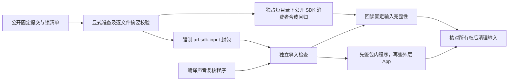

# 本机桌面构建

需要 macOS 14+、Xcode Command Line Tools，以及已安装 Friday 基础依赖的 Python 环境。
构建从当前源代码开始，不复用作者机器的原生二进制、签名证书或历史资格文件。

```sh
./scripts/install-home.sh
native/FridayDesktop/script/build_and_run.sh --plan
# 先显式取得公开固定输入；输出放入本项目独占的可清理构建区。
python3 scripts/prepare_arl_sdk.py --output /absolute/cache/path/friday-arl-sdk
native/FridayDesktop/script/build_and_run.sh --build-only --arl-sdk-input /absolute/cache/path/friday-arl-sdk
# 完成封包与验证后核对来源及清单，再清理本轮输入。
python3 scripts/prepare_arl_sdk.py --output /absolute/cache/path/friday-arl-sdk --clean
```

默认产物：`.artifacts/desktop-public/Friday.app`。默认 ad-hoc 签名；可通过
`--signing-identity` 选择自己的签名身份。构建不安装、不启动、不打开设备。

SwiftPM、中间文件和模块缓存使用
`~/Library/Caches/CodexBuilds.noindex/<项目名与路径摘要>/swift-macos/release/<任务ID>/`，
可用 `--task-id` 指定一次新的任务；`--plan` 显示实际目录。每次构建有独立清单、锁和日志。
临时安装候选也可通过 `--output` 放在该项目的缓存命名空间内；不允许写入其他项目的缓存。
构建前后核对源码摘要，安装前使用 `check_registry_package_pins.py` 检查包内来源绑定。

同一次构建将 `SoundWorker.swift` 编译到桌面包的 `Contents/Helpers/friday-sound`。
包内导入检查确认后端选中该程序，并核对可执行状态。先签包内程序，将签名后的 SHA-256
纳入来源清单，再签外层 App。声音复核启用后才会按需启动分类器。

`--arl-sdk-input` 需要包含经审核的 `ARL-SDK-MANIFEST.json`、对应源码和许可文件。
其清单摘要必须与 `homeplane/arl_sdk_requirements.json` 中的固定值一致；构建不下载 SDK，
也不覆盖所选 Python 环境。缺文件、摘要变化、额外文件或符号链接会在编译前拒绝。
冻结 SDK 随 App 放入 `product/vendor`，逐文件摘要纳入来源绑定。

公开锁清单位于 `native/FridayDesktop/Resources/ARL-SDK-MANIFEST.json`，其原始字节摘要与
唯一消费契约一致。准备器只从该固定公开提交下载所列源码、LICENSE、NOTICE 和项目元数据，
逐文件验证大小、SHA-256 与 Git blob；不执行 SDK、不克隆私有仓库、不安装依赖，也不更新
已有 Python 环境。已有输入必须完整匹配才复用，未知文件、目录、符号链接或改动均拒绝。
源下载失败会清理本轮仍匹配清单的部分输入；未知并发写入保留供人工核对。

CI 在独占的 `RUNNER_TEMP` 路径显式准备输入，供公开 SDK 回归和 macOS 封包使用，最后
调用 `--clean`。清理只接受准备器自身的来源回执及空闲锁，保留有结束状态的小型回执。
整个回归 job 设置 `PYTHONDONTWRITEBYTECODE=1`，涵盖常规导入及其子进程；固定输入
不允许生成 `__pycache__`。测试与封包后再次 `--verify-only`，清理仍按原严格清单执行。
pytest 数据另放在每次独占的短 `/tmp` 根，并同步设置 `TMPDIR`；不借用 SDK 目录或
放宽生产数据库路径校验。具体生命周期见[开发说明](development.md)。
清理还需现有 Git 与 `lsof` 核对跟踪和打开句柄；工具缺失、输入被跟踪或正在使用时拒绝
删除。macOS 通常已有这些工具，Linux CI 显式安装 `lsof`。
这条链不改变冻结 SDK 或接口要求；只比较版本字符串不能代替来源和摘要验证。



签名前分别在所选 Python 的新进程中检查后端源码导入及 ARL SDK 兼容性。
后者只调用 `homeplane.arl_application.sdk_compatibility()` 这一兼容入口；检查过程
禁止连接宿主、创建会话、启动线程、写私有配置或运行模型。任一检查失败或回执不符，
候选均不进入签名。检查通过只证明包内导入与接口齐备，实际 ARL 注册、任务执行和
家庭设备效果仍需另行验收。

当前是**本机开发包**：内置 launcher 引用构建时明确选择的本机 Python 环境。
移动或删除该环境后需要重新构建，不能把此包作为自包含正式安装包转发。
正式可分发包仍需独立的 Python runtime 打包、签名、notarization 和洁净主机验收。

显式安装使用 `native/FridayDesktop/script/install_desktop.py --candidate <app-path>`。
已有 App 需先停止并指定 `--backup`；默认不会覆盖。当前用户的私有配置保存在
`~/Library/Application Support/Friday`，从本机路径推导，不读取作者环境。

已验证候选提供显式 `Contents/MacOS/Friday --service-unregister`，仅撤销本应用的后台服务并等待
原进程退出，不改私有配置或自动启动服务；`--service-status` 只读回注册状态。换包后由使用者
打开新 App，沿原流程注册后台服务。回退副本属于安装恢复数据，不放入可清理构建缓存。
