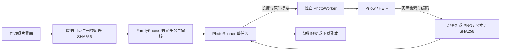

# 本机照片处理

照片编辑生成新的 JPEG 或 PNG 副本，原件保持不变。像素处理使用锁定版本的
Pillow 13.0.0 和 pillow-heif 1.8.1，不使用模型或云服务；依赖及其原生库许可见
[第三方声明](../THIRD_PARTY_NOTICES.md)。

当前提交已接通目录来源、编辑审核、真实像素生成和 HTTP 下载，也接入桌面的同源
入口。照片界面、目录选择与 macOS 文件保存交互仍在开发；接口通过不代表已安装 App
或使用者已经完成照片导出。



## 像素与格式

- 打开 JPEG、PNG、WebP、静态 GIF、单页 TIFF、AVIF 以及 HEIF/HEIC 主照片。
  HEIF 集合采用文件声明的主照片，并记录主照片编号；不把第一张擅自当作主照片。
  动图及多页 TIFF 不静默降为首帧。
- 先按 EXIF 方向转正，再依次裁剪、按四分之一圈旋转、调整曝光。
  裁剪坐标沿用 `original_normalized_after_exif_orientation`，因此操作列表顺序不会
  将裁剪框误解释为旋转后的坐标。
- 曝光的 ±2 stops 在 sRGB 对应的线性光上计算。不是对编码后的 RGB 值简单乘亮度。
  有效 ICC 转换到 sRGB；支持明确的 sRGB/BT.709 NCLX，未知 HDR 或色彩深度不会
  被静默当作普通 sRGB 输出。
- PNG 保留透明通道；JPEG 将透明区域合成白色。输出使用 sRGB，移除原件的
  EXIF、位置、XMP、注释和辅助图，不复制这些私有元数据。
- 导出前在处理子进程中重新解码输出，核对格式和尺寸。父进程另外核对长度、
  输出类型、文件签名和完整 SHA256；进程未正常结束、摘要不符或多出字节均拒绝交付。

## 生命周期与预算

`POST /api/family-media/photos/open` 只打开已经完成来源检查的图片；
`POST /api/family-media/photos/render` 使用已保存的编辑方案，分别生成预览或导出。
预览可以在审核前查看，导出必须绑定仍有效、已审核的同一方案。虚拟相册整理不会
冒充像素编辑。任务接受返回 202 和 `processing`，查询任务得到 `ready` 才有真实结果。
编辑方案本身的 `rendered_derivative: false` 仍表示方案只是元数据；独立照片结果的
`rendered_derivative: true` 则绑定实际编码内容、格式、尺寸和 SHA256。

读取仍由既有 NAS 管理器持有，以最多 1 MiB 的范围逐块取得完整原件并重新核对 SHA256。
来源未完成、原件字节与目录摘要不符、会话或配置变化、审核撤回时不交付结果。
处理前后与每次下载都核对原有来源及元数据版本；元数据版本不是不可变快照，
因此不声称在两次读取之间能发现来源未更新元数据的所有改写。

接口不接收原件路径、上游网址或凭据。桌面只开放固定类型的本机同源操作，
原件读取与删除仍保持原有限制。下载由独立合格派生内容入口交付，使用明确 MIME、
`no-store`、`nosniff`、副本文件名与完整内容摘要，不复用原件的二进制读取入口。

输入最多 64 MiB、5000 万像素、128 张集合成员，输出最多 32 MiB。
预览最长边最多 2048 像素，记录的原图尺寸不被预览缩放覆盖。
输出写入时即检查容量，不在生成无限缓冲后才检查。

照片服务最多保留 8 条任务、64 MiB 输出，并在开始处理前预留单次 32 MiB 的输出预算。
同时只处理一项，不创建无界等待队列。整个读取与处理任务限时 60 秒；结果最多保留
10 分钟，导出还受原编辑方案期限限制。任务编号支持同一期限内的重试去重，相同编号
不能改成另一项请求。到期、取消和关闭释放内存，取消后不能继续下载。
网页下载开始不等于文件已经保存，所以接口始终保留 `saved_to_file: false`。

一个 `PhotoRunner` 同时只持有一个处理任务，不排队启动更多子进程。
默认处理期限为 15 秒，父进程监控该子进程的 RSS，900 MiB 以上停止；
子进程另设 CPU、文件描述符和文件写入限制，HEIF 解码使用两个线程。
像素数据只通过有长度上限的内存管道交换，不写临时原图。

取消、超时、内存超限或协议失败后，先终止并回收子进程再释放名额。
启动句柄迟到和重复取消也由原任务继续持有，不能为释放界面等待而遗留进程。
子进程不接收路径、网址、NAS 凭据或可执行指令；库的标准输出与媒体协议分离，
错误只返回固定代码。

## 验证

在锁定依赖中运行：

```sh
python -m pytest tests/test_photo_codec.py tests/test_photo_runner.py tests/test_family_photos.py -q
```

检查使用合成像素和真实本机编解码器，包含 HEIC 编解码、原件像素对照、八种 EXIF
方向、裁剪与旋转顺序、透明度、曝光、元数据、错误/超限图片和真实自有子进程。
还覆盖真实路由与桌面包装层、审核、完整源摘要、下载像素、请求重试、容量、
来源变化、期限、取消和迟到进程句柄。产品默认启动命令在安装完整锁定依赖的
全新 CI 环境验证；本机仅注入已核验的隔离编解码器输入，保留现有运行环境。
HEVC 的“无损”指其编码颜色空间，RGB/YCbCr 往返仍可能量化；导出对照使用原文件
实际解码像素，不将编码前的合成 RGB 值冒充原件证据。

这些检查不读取真实家庭照片，不启动摄像头、麦克风、模型、电视或设备动作。
真实照片的色彩、导出体验和当前安装版另行验收。
