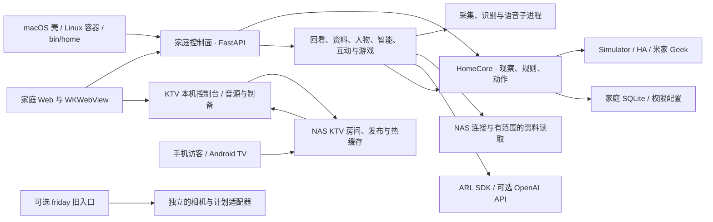

# Friday 架构治理

基线为远端主干 `1481cf06cb437504ef7c7046d46cc5a2ac773527`。范围包括家庭控制面、
感知与本地推理、家庭资料、游戏与 KTV、各端壳层、受支持的历史入口，以及部署和验证工具。
功能时序、权限和物理验收的细节沿用[架构](architecture.md)、[隐私](privacy.md)和[部署](deployment.md)。

## 运行边界与依赖方向

箭头表示调用方使用的下一层。相同层内的源码依赖可由文末的静态图命令查询。



KTV 的两条运行时请求方向有不同职责。Worker 向 NAS 领取任务并发布成品，
协调房间的 NAS 可向明确配置的私有音源服务读取数据。静态 Python 导入图独立于这两条网络契约。
狼人杀手机席位与体感游戏遥控各有自己的会话范围。

## 模块与状态所有权

| 业务边界 | 权威实现与接入面 | 状态、权限或兼容约束 |
| --- | --- | --- |
| 家庭应用装配 | `homeplane.api.create_app` 挂载 HTTP、静态资源与生命周期。 `homeplane.cli` 提供 doctor、模拟、schema、服务入口 | 装配层持有服务实例和接入锁。业务结果由各服务读回。默认运行 Simulator |
| 设备与读模型 | `HomeCore.snapshot`，`contracts.py`，`devices.py`，`quality.py`；接入者为 `HAReadOnlyAdapter`、`Simulator`、`GeekSession` | 外部注册表、事件与回读由对应来源拥有。 `TraceStore` 保存本地事件与可追溯回执。HA REST 与 WebSocket 接受来源切换和观察中断 |
| 动作与自动化 | `ActionController` 与 `action_contracts.py`。 `rule_contracts.py` 描述意图、执行和持久指纹，`core_rule_contracts.py` 持有审核与持久回执格式。 `rule_compiler.py` 编译和试算，`CoreRules` 审核落盘，`CoreRuleRuntime` 接纳实时事件 | 动作权限文件、幂等领取、当前家庭模式租约与持久回执各有独立语义。 `CoreSchedule` 消费日历时点。外部自动化目录仅观察 |
| 家庭问答、空间与测量 | `home_flow.py` 组织交互会话，`HomeQueries` 提供带来源的只读查询，`home_layout.py` 持有导入几何，`MeasurementSettings` 与 `SensorQualityEngine` 持有校准及派生质量 | 保持源坐标和缺失位置。会话状态在进程内，布局与来源配置在私有存储。测量校准和暂时排除以稳定来源为界 |
| 感知、交互、声音与异常留档 | `EmbodiedService` 装配 `embodied/worker.py`、副镜头、语音和互动路径。 `SafetyRuntime` 判定，`SafetyRecorder` 写入，`SafetyIO` 控制 SQLite 操作 | 采集会话、云台意图、帧新鲜度、隐私许可和子进程回收各归实际控制者。已确认留档与仍有效的新输入分别判定 |
| 人物与识别 | `recognition_contracts.py` 定义识别数据，`recognition_feature_handoff.py` 管理私有候选，`PeopleCatalog`、`people/live.py` 管理本地观察归组、登记和撤销 | 标签与识别回执独立于认证。不同受信输入的临时特征和持久身份不可互换 |
| NAS、回看和照片 | `NASConnectionManager` 管理连接，`ArchiveIndex`、`archive_playback.py`、`archive_privacy.py` 管理索引和受保护播放，`FamilyMediaCatalog` 管理有范围的资料及照片配方 | NAS 原始媒体归上游。索引、播放计划及处理副本使用各自的寿命。Pydantic 模型拥有资料契约，导出 schema 由回归校验 |
| 文件管家 | `FileSteward` 管理审核和任务，`file_steward/extraction_queue.py`、`search.py` 管理抽取租约和索引阅读 | 同一 SQLite 中的任务、预算、页、游标、策略版本和可恢复回执有持久契约。独立 Apple provider 冻结协议源码和哈希 |
| 智能和可观测性 | `IntelligenceRuntime` 协调用途、路由与回退；`intelligence/settings.py`、`budget.py` 持有设置和用量。 `arl_application.py` 持有 SDK 宿主对接。 `runtime_log.py` 管理运行事件 | ARL 回执、API 用量和备用执行是不同契约。家庭诊断用固定事件码和有界字段，KTV NAS 保留独立进程的诊断与错误契约 |
| 家庭 KTV | Mac 的 `ktv_service.Queue`、`ktv_worker.py` 管理制备。NAS 的 `nas_server.Store`、`Coordinator` 管理房间与控制。 `audio_format.py` 提供跨运行时媒体契约 | Mac 作业及本地归档、NAS 房间和签发清单、电视播放执行分别有所有者。旧 WAV 和旧电视兼容继续由能力与清单校验支撑 |
| 家庭游戏 | `motion_games.py` 持有体感局状态，`game_presentation.py` 管理显示窗口，`WerewolfService` 管理席位、局面与宿主操作 | 游戏占用由当前镜头所属房间和游戏修订共同决定。电视壳和手机席位持有自己的恢复凭证和连接状态 |
| Web 与原生界面 | `DESIGN.md` 描述设计规范，`homeplane/static/interface.css`、`style.css` 供家庭控制台使用，具体页面由同目录模块拥有。KTV 访客、KTV 控制台、游戏及 TV 有独立入口 | Web 显示读取协议状态。原生壳负责本地导航、服务可用性和播放。出厂、系统外观、深色、键盘、减少动态效果各有真实使用约束 |
| 配置与交付 | `SettingsService`、各领域设置与 `platform_paths.py` 持有配置及默认路径。 `pyproject.toml` 和 `uv.lock` 持有 Python 依赖。Docker、SwiftPM、Android、Node 分别有入口和锁定输入 | CLI 环境变量、已安装 App 私有配置、独立进程与容器入口是对外契约。打包与发布保留摘要、签名和许可检查 |

### 运行技术清单

| 运行形态 | 入口与验证 |
| --- | --- |
| 本机控制面和 macOS 壳 | `bin/home`、Python 3.11+、FastAPI、Pydantic、SQLite、原生浏览器脚本。 `native/FridayDesktop` 以 SwiftPM、AppKit/SwiftUI 与 WKWebView 挂载本机服务。 `tests/` 和 `native/FridayDesktop/tests/` 各有回归 |
| 摄像头及本机模型 | `homeplane/embodied` 的子进程协议，`native/EmbodiedVision` 与 `native/PortableVision` 的平台实现。可选 `native/PortableReview`、`native/PortableSeparation` 有独立的模型依赖和锁 |
| CPU 容器 | `docker/entrypoint.py` 启动家庭服务。 `docker/runtime-lock.json` 与 `docker/camera-sdk-lock.json` 固定输入。镜像由 `scripts/build_linux_container.py` 组装 |
| 极客版与安装维护 | `workers/geek` 使用 Node 和 npm 锁。 `native/GeekConnector` 持有原生连接助手。 `integrations/miloco_recovery` 处理 Miloco 安装与升级的恢复生命周期 |
| KTV 与安卓电视 | NAS 在 Python 3.8+ 标准库上独立运行，页面由 `integrations/ktv_public/web/` 提供。Mac 可使用 `integrations/ktv_source` 的 Node 音源及原生登录桥。 `native/KTVTV` 使用 Java、JNI、C++ 和设备音频接口。 `native/KTVAudio` 是本机音频工具 |
| 历史与冻结接口 | `friday/` 经 `scripts/start-legacy.sh`、`start-stack.sh` 等入口消费。 `schemas/codex/` 按 SDK 版本保存协议快照。 `integrations/apple_document_provider_v2/protocol-snapshot/` 保留独立审核所需的固定快照 |
| 持续集成 | `ci.yml` 固定 Python 3.12 与 Node 24，在 macOS 和 Linux 做合成回归、媒体、源码隐私和依赖检查。 `container.yml` 单独验证 CPU 镜像。 `development-policy.yml` 检查协作规范 |

## 重复实现与规范偏离

| 位置 | 已核对的证据或待验证的风险 | 治理方向 |
| --- | --- | --- |
| KTV 音频能力上报 | `ktv_nas_bridge.audio_playback` 和 `nas_server.audio_playback` 函数体相同，测试也要求两端输出一致 | 复用独立 NAS 与 Mac 都能加载的 `audio_format.py`，保留拒绝码和旧电视默认值 |
| 本机子进程持有 | `scene_process.owned` 和 `local_child.owned` 相同，场景进程还重复终止、清空管道和回收；场景的可重试状态与其他进程关闭语义不同 | 先验证槽位、取消、重启和状态，找能移除的重复责任 |
| 家庭日历与规则 | 原日历反向导入编译器，调度与提醒反向导入运行时 | 指纹、日历、审核和回执依赖已厘清。CI 禁止重新引入原循环 |
| 入口与 transport | HTTP doctor 反向依赖 CLI。HA WebSocket 从 HA adapter 导入解析私有函数。事件来源登记直接读取具体适配器私有字段 | 分别处理共享诊断输出、消息校验、来源身份契约，保持 HTTP 及事件指纹兼容 |
| 文件管家 | `service.py` 挂载设置、队列、全文搜索、单页提取，这些子模块反向依赖其错误类型、上限或标识 | 让它们依赖窄的契约与数据访问入口。冻结的独立 provider 保留其协议快照 |
| 界面基础 | 文档色值与运行时 CSS 都有维护成本。家庭控制台多个功能以全局挂载，KTV 两套页面已共用 `party-audio.js` | 先找同语义的生产调用方和回归，再迁移。跨端显示方式须依据实际平台能力 |
| Schema 和工具 | 多个 Pydantic 导出器有重复序列化。公开 schema、Codex 版本快照和测试夹具服务于不同消费场景 | 核验导出命令、已跟踪文件与历史消费版本。冻结快照和可再生文件分别验收 |
| 错误、重试和权限 | HA 重连读状态、动作结果不明、模型回退、文件领取和 KTV 任务恢复各有不同重放风险 | 只归并同一生命周期与拒绝契约。保留设备结果不明时的拒绝重放、媒体授权和账号域 |

## 架构决策记录

### 001 · 将静态循环依赖列为可执行约束

盘点了全树的一方运行入口，并以 AST 对 `homeplane/`、`friday/` 做静态导入图。
基线有 331 个模块、982 条导入边，15 个强连通分量中共有 54 条循环边。
函数内导入也计入。第三方 vendored 模块、隐式包初始化、运行时字符串导入、
HTTP 和跨语言边由上面的运行图及各平台回归覆盖范围说明。

考虑过按目录机械分层、只做报告，以及约束已知循环边。采用第三种方案，
使每轮只删除已经验证不再依赖的边，保留可定位的历史债务。合并前检查拒绝新增循环边和过期记录。
工作队列按能独立验收的切点推进。接口的保留以真实调用和封装责任为依据。 [John Ousterhout 设计课讲义](https://web.stanford.edu/~ouster/cs190-winter24/lectures/aposd/)

```sh
uv run --no-sync python scripts/check_architecture.py
uv run --no-sync python scripts/check_architecture.py --graph
```

### 002 · 让自动化契约独立于编译和运行时

考虑过保留函数内导入、把时钟匹配放进编译器，以及让双方依赖规则契约。选第三种。
日期算法继续拥有时区、跳时和重复时点判断，指纹编码由规则契约拥有。
在调度和提醒中注入运行时类型会保留上下层的语义依赖，因此把持久回执和审核类型迁至
独立模块，并迁移 HTTP、CLI、原生验证器和其他读取方。新模块可在未装配服务时导入。
三个已跟踪 schema 在基线已和运行时导出不同，本批的五项运行时 schema 比对均一致。

### 003 · 划分 Laya 引擎与宿主装配

引擎拥有模型驻留、时限、日志队列和资源释放。ARL 宿主拥有单实例、对端身份和关闭顺序。
保留安装器与宿主入口，迁移引擎测试和所有加载方。隔离发布源的真实导入比对能发现
静态列表漏掉的传递依赖，也无需启动模型或服务。

## 优化任务池

| 任务 | 收敛条件 | 状态 |
| --- | --- | --- |
| 自动化指纹、时钟、回执 | 编译器、日历、调度、提醒无循环导入。旧规则、指纹和收据可按原格式读取 | 已完成 |
| KTV 音频上报与工人依赖 | 同一个上报解释，Mac/NAS 独立入口可加载；音视频工具和 Worker 无需依赖 HTTP 组装层 | 待迁移 |
| 家庭控制面入口与 HA 来源身份 | CLI 与 HTTP 消费同一个诊断报告。HA 和 Simulator 拥有自身来源证据，持久摘要稳定 | 待迁移 |
| 文件管家 | 设置、索引和队列不反向导入运行时；保留持久记录、Apple provider 和所有读取权限 | 待迁移 |
| 感知与子进程 | 场景、留档、复核、云台和 UDP relay 各自的输入和退出责任无循环；通过取消与回收回归 | 待核对运行顺序 |
| 人物、测量、Geek、ARL | 挪出领域契约或明确生命周期调用方向，继续支持原协议和旧数据。Laya 依赖迁移已验证，ARL 应用生命周期另行治理 | 部分完成 |
| 家庭展示与互动 | 共用同一份房间和设备展示规则，消除 household、interaction、home_experience 的反向依赖 | 待验证默认行为 |
| UI、schema 与工具 | 逐项识别同义的 CSS、辅助函数和导出器，保留快照与不同端入口；每批有实际消费者覆盖 | 待验证行为等价 |
| 移除独立入口或改变持久数据 | 旧 API、旧 KTV 客户端、冻结协议及共享库的移除需要兼容决策；跨库迁移需要部署和明确回滚窗口 | 待产品决策 |

## 进度

| 批次 | 结果与复查 |
| --- | --- |
| 001 · 仓库盘点与依赖基线 | 记录运行边界、状态所有者和治理候选。AST 检查和两项合成回归通过。首次全量基线早于 SDK 准备完成，收集失败，后续先校验固定输入再运行 |
| 002 · 自动化契约 | 定向基线 334 项通过，迁移后含新增核验共 346 项通过。五项运行时 JSON Schema 逐项摘要相同，迁移的八项定义 AST 相同。循环边 54 → 48 |
| 003 · Laya 与 ARL 宿主 | 安装源清单纳入引擎和已被使用的平台路径模块。重建的独立目录可加载宿主入口。固定 SDK 回归 63 项、本机 ARL 源码合成回归 33 项通过 |
| 004 · 隔离回归工具链 | 完整基线 5412 项通过，44 项跳过，5 项因 Geek 安装与 KTV 子进程夹具失败。修正路径与进程就绪夹具后，两组共 45 项通过。JS 全套 491 项通过 |
