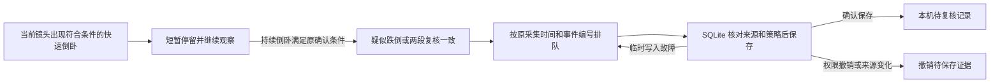
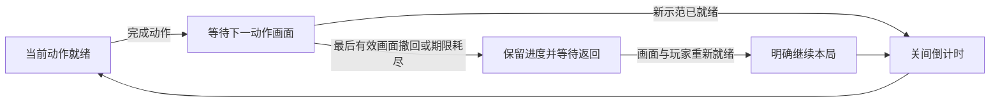

# Architecture

`homeplane/` is the current control plane; `friday/` retains the optional legacy
camera-oriented API. The default homeplane adapter is the explicit Simulator.
HA ingress reads states and area/device/entity registries. Action planning and
execution have separate capability, authority, freshness and idempotency checks.
Unknown results do not trigger blind retries.

The browser renders source-backed state and optional imported geometry.
`home_layout.py` validates and privately persists Mi Home imports.
`home_presentation.py` maps discovered functions to generic display styles.
`embodied/` owns optional camera workers, speech, gestures and bounded recognition;
it is not required to run the Console. Device discovery does not enable gestures.

The macOS shell is a client of a user-owned household service. Its private paths
are derived from the current user; it does not embed an author's repository path,
login session or signing identity. NAS and People content stay local. Optional
ARL provides the model-runtime boundary and is not a prerequisite for simulation.

## 异常留档

`SafetyRuntime` 只把已经判定的疑似跌倒或完成两段印证的复核交给 `SafetyRecorder`。
保存和重试使用同一个事件编号，SQLite 写事务内重新检查镜头和策略。留档队列仅保留事件信息与关键帧。
声音与画面继续各自串行识别，复核待留档时可以让下一台镜头先使用识别通道。

主副镜头从新鲜视频帧续期语音和注意力采集窗口。视频处理在控制管道积压时跳过续期，继续送出画面与观察结果。
采集进程按命令携带的单调时钟截止时间关闭窗口。窗口断开后，重新打开时从新的 PCM 分段开始。

声音分类保留经过本机词表确认的婴儿哭声标签。`SoundReviewer` 用同一来源的采样序号和采集时间连接三段各两秒的阳性结果。
两段可信证据后的第三段可以取得一次额外复核机会，使用已有的有限镜头停留。第三段未印证时，仍可将有效的前两段保存为普通哭声。
持续哭声沿原私有留档写入一条待核对记录，保留同时段的画面。旧记录继续使用原标签。

快速倒卧开始确认后，原主副镜头在决定及提交自动转向时读取当前姿态或留档状态，
有界保留原视角。姿态继续走同一个跌倒确认器，留档仍要求原来源和策略。

## 游戏画面与关间衔接

滑雪通过现有状态快照提供规则生成的赛道坐标和每扇木门的判定宽度。画面用同一批坐标绘制滑痕、木门和终点，随已观测距离变化。完整结束后，各段穿门成绩从同一场的已判定结果汇总；画面不重新计分。

网球按镜像视图的起始站位分配本局编号，并沿用同一组追踪槽位。站位等待时，`tennis.lineup` 按槽位给出就位、需站定、脚部出画或玩家出画的状态。`tennis.guide` 从击球规则读出当前接球人、落点、范围与难度对应的击球窗口，供同一个计分区和球场画面使用。

山径冒险与运动训练由 `BodyMotion` 提取可见关节的动作信号。单腿站立要求支撑腿伸直、另一脚抬起并稳定保持 1 秒。交叉触膝要求抬膝并用对侧手靠近。回到站姿才计次，连续计次须交替两侧。暂停或丢失玩家时撤回尚未完成的动作。互动控制的“试一试”复用同一套动作规则，完成一次即回显结果。关卡和教学使用同一动作标识，减少动态效果时使用同源的定格图。

`MotionGames` 决定本局进度，`GamePresentation` 只接纳有界的画面可见性与素材就绪回执。同局同模式的相邻动作切换时，保留上一有效回执剩余的可见期限等待新画面；不延长期限、不继承素材就绪，也不推进动作或关间时钟。当前动作的示范已经挂载且素材可用后，页面才申报就绪。

新关已受理的可见或隐藏回执都会接管旧期限；关闭回执先于首次可见回执到达时，同样撤回继承资格。另一块当前已就绪的画面仍可维持游戏。没有有效画面时保留已赚进度，仍需原摄像头、玩家与来源检查，以及使用者明确继续。

本轮没有新增显示协议字段或设备权限。原规则、API、合成关节及浏览器交互验证分别记录；这些结果不替代真实玩家、电视或声学验收。
