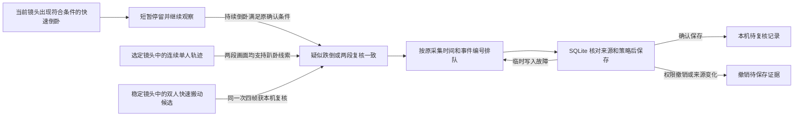
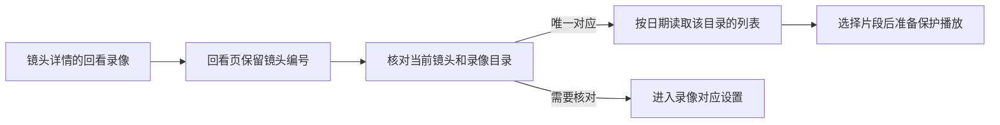
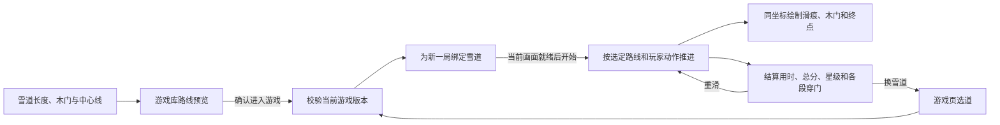
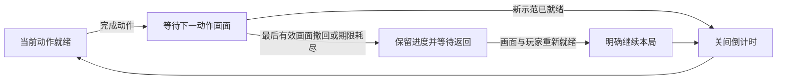
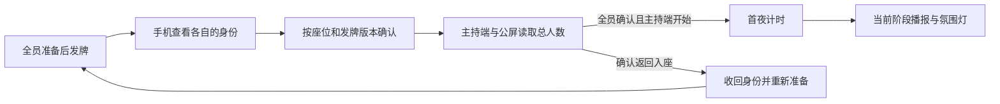
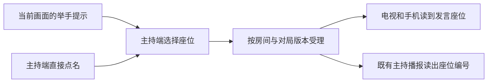
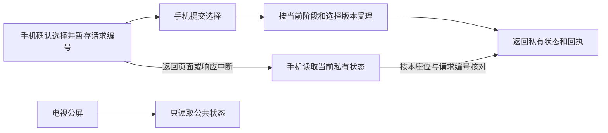

# Architecture

`homeplane/` is the current control plane; `friday/` retains the optional legacy
camera-oriented API. The default homeplane adapter is the explicit Simulator.
HA ingress reads states and area/device/entity registries. Action planning and
execution have separate capability, authority, freshness and idempotency checks.
Unknown results do not trigger blind retries.

The browser renders source-backed state and optional imported geometry.
`home_layout.py` validates and privately persists Mi Home imports.
`home_presentation.py` maps discovered functions to generic display styles.
`embodied/` owns optional camera workers, speech, gestures and bounded recognition;
it is not required to run the Console. Device discovery does not enable gestures.

The macOS shell is a client of a user-owned household service. Its private paths
are derived from the current user; it does not embed an author's repository path,
login session or signing identity. NAS and People content stay local. Optional
ARL provides the model-runtime boundary and is not a prerequisite for simulation.

## 单轮巡视

摄像头详情通过原 `/control` 路由启动单轮巡视，回执带当前操作版本。主副镜头使用同一个 `CameraDirector`，按平视、下探、低位横扫和抬回的顺序执行。前一步在同一采集会话与背景基准上取得两次独立的预期轴向变化后，才进入下一步。全程十步，发送前预留的尝试总计至多十二次。停止巡视写入停留意图，晚到的旧版本画面状态不能恢复旧控制。

主动巡视以选定镜头的背景为准。背景配准遮除识别到的人物区域，普通在场、其他镜头的占用和语音选人信号可与巡视同时发生。当前镜头需要复核时，原停留窗口优先；复核结束或窗口用尽后，按当前画面继续评估下一步。

来源或背景基准变化、云台结果不明或游戏接管时结束当前路线。副镜头重连保留已确认步数，并等待新的单轮巡视请求。普通自动巡视继续采用原有的水平搜索和失败退避。

## 异常留档

`SafetyRuntime` 只把已经判定的疑似跌倒或完成印证的复核交给 `SafetyRecorder`。
保存和重试使用同一个事件编号，SQLite 写事务内重新检查镜头和策略。留档队列仅保留事件信息与关键帧。
声音与画面继续各自串行识别，复核待留档时可以让下一台镜头先使用识别通道。

主副镜头从新鲜视频帧续期语音和注意力采集窗口。视频处理在控制管道积压时跳过续期，继续送出画面与观察结果。
采集进程按命令携带的单调时钟截止时间关闭窗口。窗口断开后，重新打开时从新的 PCM 分段开始。

声音分类保留经过本机词表确认的婴儿哭声标签。`SoundReviewer` 用同一来源的采样序号和采集时间连接三段各两秒的阳性结果。
两段可信证据后的第三段可以取得一次额外复核机会，使用已有的有限镜头停留。音频中断、第三段未印证或超过等候期限时，来源及授权仍然有效的前两段会按普通哭声保存。
每个分析段在提交分类前选择本机接收时段内的一张代表画面。事件沿原私有留档写入一条待核对记录，以最后一段有效音频的接收时间关联回看。没有对应画面时仍保存声音复核记录。

画面复核提交前淘汰超过五秒的四帧窗口，防止采样抖动使模型子进程退出。趴卧复核在「监测设置」选定一台摄像头后，绑定该摄像头的实际采集来源。两个不重叠的四帧窗口须对同一连续轨迹给出一致线索。目标出画、多人入镜、镜头或策略变化时，先前窗口失去印证资格。通过后写入「疑似趴卧」和八张本机关键帧，按原留档路径供家人查看。

快速搬动复核从两条连续人物轨迹筛出一次可见动作，将其四张画面冻结在已授权镜头的短窗口中。
短窗口沿用 `TemporalReviewer` 的模型进程、资源预算与去重记录。同一轮只优先处理一个短窗口，
随后让就绪的常规窗口继续。来源与策略仍有效且模型支持该线索时，`SafetyRecorder` 以同一个事件编号保存完整四帧。

快速倒卧开始确认后，原主副镜头在决定及提交自动转向时读取当前姿态或留档状态，
有界保留原视角。姿态继续走同一个跌倒确认器，留档仍要求原来源和策略。

## 从镜头回看录像

镜头详情将镜头编号传给回看页。回看页沿用原录像目录和保护播放服务，查询时提交该编号和选定日期。服务核对已保存的录像来源与当前镜头来源。唯一的有效对应关系决定读哪个目录，配置缺失、来源变化或存在多条对应时提示核对设置。

预览轮询、画面与停止凭据跟随当前镜头详情。退出详情时回收该预览。收到打开镜头的回执后，启动预览仍要求详情在当前页面打开。

## 游戏画面与关间衔接

滑雪的三条雪道由 `ski_route.py` 定义。游戏库通过 `GET /api/games` 读取雪道长度、门数和中心线。确认开局后，Console 将选定的 `ski_trail` 连同页面读回的当前游戏版本传给原 worker，并核对 worker 读回。游戏页只能用选择命令换道，开始命令沿用已选雪道，且仍须当前画面就绪。

快照里的实际门宽受难度影响。完成后，规则按已判定的穿门结果汇总分段成绩，并记录滑行累计用时。重滑保留选道和难度，清除上一局进度。暂停或画面中断时保留已取得的成绩。

网球按镜像视图的起始站位分配本局编号，并沿用同一组追踪槽位。站位等待时，`tennis.lineup` 按槽位给出就位、需站定、脚部出画或玩家出画的状态。`tennis.guide` 从击球规则读出当前接球人、落点、范围与难度对应的击球窗口，供同一个计分区和球场画面使用。

网球由 1 号发第一球，首分后换发，此后每两分轮换。`tennis.serve` 在等待开球时提供发球人和就绪状态。两人入镜且发球手停稳后，只有发球人的新挥拍会启动同一套飞行与回球判定。暂停或站位丢失会撤销就绪状态。球场、记分牌和可选击球声使用规则确认的发球事件。

山径冒险与运动训练由 `BodyMotion` 提取可见关节的动作信号。单腿站立要求支撑腿伸直、另一脚抬起并稳定保持 1 秒。交叉触膝要求抬膝并用对侧手靠近。回到站姿才计次，连续计次须交替两侧。暂停或丢失玩家时撤回尚未完成的动作。互动控制的“试一试”复用同一套动作规则，完成一次即回显结果。关卡和教学使用同一动作标识，减少动态效果时使用同源的定格图。

`MotionGames` 决定本局进度，`GamePresentation` 只接纳有界的画面可见性与素材就绪回执。同局同模式的相邻动作切换时，保留上一有效回执剩余的可见期限等待新画面；不延长期限、不继承素材就绪，也不推进动作或关间时钟。当前动作的示范已经挂载且素材可用后，页面才申报就绪。

新关已受理的可见或隐藏回执都会接管旧期限；关闭回执先于首次可见回执到达时，同样撤回继承资格。另一块当前已就绪的画面仍可维持游戏。没有有效画面时保留已赚进度，仍需原摄像头、玩家与来源检查，以及使用者明确继续。

本轮没有新增显示协议字段或设备权限。原规则、API、合成关节及浏览器交互验证分别记录；这些结果不替代真实玩家、电视或声学验收。

## 狼人杀发牌与首夜

主持端发牌后，规则进入无倒计时的认牌环节。手机用当前座位凭据读取自己的身份并提交当前版本的确认。每个座位只计一次，主持端和公屏读到的是已确认总人数。房间锁内确认全部座位完成后，主持端的下一环节命令才会进入首夜。

返回入座会收回原身份、清除准备与认牌状态，更新对局版本。主持端可移除无法恢复的座位，让玩家重新扫码。旧版本的确认不能计入新一轮发牌。认牌期间可以播报公共提示，夜间灯光从首夜开始切换。

## 狼人杀点名发言

白天可以在主持端点名、换人或结束发言。已对应座位的镜头举手提示会标在名单里。主持端发送当前房间、对局版本和请求编号，规则在同一房间锁内核对玩家仍在场，平票发言只接受平票座位。

确认后的发言座位在镜头离线时仍由规则保留。暂停冻结本环节倒计时，恢复时回到原座位。换人不重置本环节时间，进入投票时清除发言状态。摄像头信号不提交投票。主持播报共用既有输出与静音设置。

## 狼人杀断线恢复

`WerewolfService` 在房间锁内校验阶段版本和手机读到的选择版本。同一座位每次成功提交都会更新选择版本。
同编号同内容的重试先匹配原摘要并返回当前状态。已记录的请求不会因重试再次计入，
同阶段内迟到的旧请求也不能覆盖已更新的选择。

手机通过 `GET /api/player` 的 `X-Friday-Choice` 请求头查回执。未确认时由玩家重新选择并确认。
手机与大屏在同步期间隐藏旧倒计时。大屏保留座位和已经公开的投票结果，暂时收起主持提示及镜头提示，拿到新快照后继续显示当前环节。
