# Architecture

`homeplane/` is the current control plane; `friday/` retains the optional legacy
camera-oriented API. The default homeplane adapter is the explicit Simulator.
HA ingress reads states and area/device/entity registries. Action planning and
execution have separate capability, authority, freshness and idempotency checks.
Unknown results do not trigger blind retries.

The browser renders source-backed state and optional imported geometry.
`home_layout.py` validates and privately persists Mi Home imports.
`home_presentation.py` maps discovered functions to generic display styles.
`embodied/` owns optional camera workers, speech, gestures and bounded recognition;
it is not required to run the Console. Device discovery does not enable gestures.

The macOS shell is a client of a user-owned household service. Its private paths
are derived from the current user; it does not embed an author's repository path,
login session or signing identity. NAS and People content stay local. Optional
ARL provides the model-runtime boundary and is not a prerequisite for simulation.

## 首页家庭感知

主镜头和副镜头的采集控制者分别发布自己的识别状态与最近一次已处理画面的耗时。
只统计当前仍有有效识别画面的镜头。关闭镜头、画面过期或读取途中切换服务后，撤下对应旧读数。
首页从现有状态接口统计感知中的镜头，显示当前读数里最慢的画面处理耗时。
该耗时从本机收到画面算起。CPU 和内存各自读取主机采样。

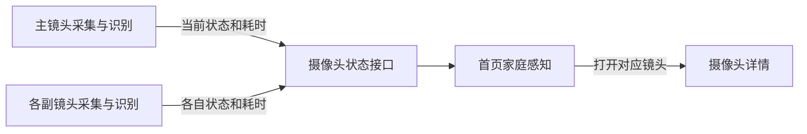

局部画面中断显示在服务状态内，沿用采集控制者的自动恢复。
从首页打开镜头详情时只读取当前状态，预览需单独操作。

## 本机识别恢复

主、副镜头各自管理原生识别子进程。识别管道出错时，撤销旧的识别画面、人物轨迹、未完成的监测候选与自动动作准入，保留仍有效的采集连接。已确认原子进程退出且退避结束后，用下一张新画面启动识别。体感游戏保留本局已取得的进度，依照原有恢复流程重新确认玩家。

已打开的实时预览从原采集连接读取新鲜画面。镜头详情显示「感知恢复中」，自动跟随、巡视启动和异常判定等待有效识别。关闭镜头或采集断开会撤下实时画面，仍走原有的隐私和断线恢复路径。

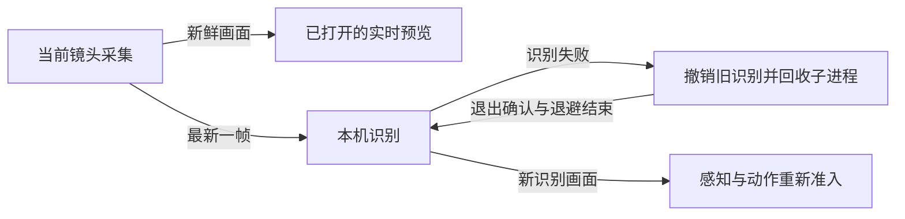

## 单轮巡视

摄像头详情通过原 `/control` 路由启动单轮巡视，回执带当前操作版本。主副镜头使用同一个 `CameraDirector`，按平视、下探、低位横扫和抬回的顺序执行。前一步在同一采集会话与背景基准上取得两次独立的预期轴向变化后，才进入下一步。全程十步，发送前预留的尝试总计至多十二次。

详情读取已有的预览状态取得当轮计数与结果。新意图生效后，控制者在下一张有效画面到来前清除前轮计数和结果。结束查看只收起画面，停止巡视仍可提交带当轮版本的停留意图。主副镜头各自在写入前核对版本，拒绝已过期的停止请求。

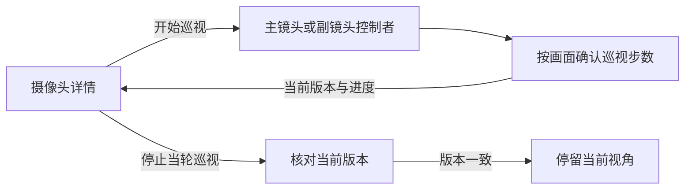

主动巡视以选定镜头的背景为准。背景配准遮除识别到的人物区域，普通在场、其他镜头的占用和语音选人信号可与巡视同时发生。当前镜头需要复核时，原停留窗口优先；复核结束或窗口用尽后，按当前画面继续评估下一步。

来源或背景基准变化、云台结果不明或游戏接管时结束当前路线。采集结束时以当前已确认步数报告完成或中断。副镜头重连保留已确认步数，并等待新的单轮巡视请求。普通自动巡视继续采用原有的水平搜索和失败退避。

## 云台跟随

主副镜头将跟随判断与同一张识别图绑定。已识别的人物沿用当前身份读回。未识别人物及猫狗在发出跟随转向前记录目标框内部的局部特征，转动后在同一配准基准中比较目标位置和画面。新的跟踪框需要在两张独立新画面中都取得唯一对应，随后继续跟随。画面中仍有其他目标且八秒内无法确认原目标时，提示重新跟随。画面特征随跟随模式、采集会话或游戏占用变化清除。

实时画面中的「选择跟随目标」由当前镜头控制者处理。进入选择时暂停云台自动移动。用户点选同一识别帧中的编号后，控制者重新核对来源、视角、选择版本和目标轨迹。宠物选择等待当前版本的猫狗识别。点选后，两帧新的识别结果都必须看见所选目标。短暂遮挡或轨迹中断后，镜头停在当前视角，等两帧分别确认同一登记身份或同一视野内的唯一画面对应。轨迹编号变化会撤销尚未发出的转向，确认后由新画面重新决策。目标无法确认时可重新点选。重启服务或更换采集来源后，需要重新选定目标。

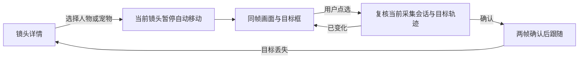

## 异常留档

`SafetyRuntime` 只把已经判定的疑似跌倒或完成印证的复核交给 `SafetyRecorder`。
保存和重试使用同一个事件编号，SQLite 写事务内重新检查镜头和策略。留档队列仅保留事件信息与关键帧。
声音与画面继续各自串行识别，复核待留档时可以让下一台镜头先使用识别通道。

主副镜头各自只排队最新一帧的检测快照，保留最多十个轨迹的边界框、相关关节和身份时戳。
单人趴卧和双人快速搬动仍检查人数。采集来源的撤销状态在其有效期间复用，换源后旧帧及其待写事件失效。

监测策略通过独立的 SQLite 只读连接刷新。事件写入排队时，只要策略可读，识别继续使用当前版本。
读取失败会暂停新候选。关闭监测或切换版本会撤销旧来源和待写事件，真正落盘前仍在写事务中核对授权。
过期事件和画面由原写入线程定时清理，写入与读取任务均随服务退出回收。

主副镜头从新鲜视频帧续期语音和注意力采集窗口。视频处理在控制管道积压时跳过续期，继续送出画面与观察结果。
采集进程按命令携带的单调时钟截止时间关闭窗口。窗口断开后，重新打开时从新的 PCM 分段开始。

声音分类保留经过本机词表确认的婴儿哭声标签。`SoundReviewer` 用同一来源的采样序号和采集时间连接三段各两秒的阳性结果。
两段可信证据后的第三段可以取得一次额外复核机会，使用已有的有限镜头停留。音频中断、第三段未印证或超过等候期限时，来源及授权仍然有效的前两段会按普通哭声保存。
每个分析段在提交分类前选择本机接收时段内的一张代表画面。事件沿原私有留档写入一条待核对记录，以最后一段有效音频的接收时间关联回看。没有对应画面时仍保存声音复核记录。

「异响后环视」默认关闭，单独保存设置并与监测策略共用版本。`SafetyRecorder` 确认异响已保存后，`SoundReviewer` 才向同一来源交出短时回执。主副镜头在决策和提交云台动作前都检查当前采集、策略、自动模式和视野。环视检查来源镜头是否有人，普通自动巡视继续参考其他镜头的在场状态。空画面最多做三次水平转向，依次查看起始视角两侧。前一步取得两次独立的同向画面变化后才会继续。发现人物后，沿用原视觉跟随逻辑。

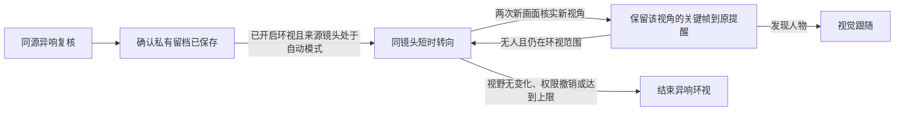

每步核实后，主副镜头提交该次读回的画面和原留档回执。写入在后台沿用私有留档库，核对事件、镜头、采集会话和设置版本。同一步重复提交只保留一张，最多保留三个新视角。转向回执本身不会生成关键帧，原异响时间继续用于关联附近录像。

画面复核提交前淘汰超过五秒的四帧窗口，防止采样抖动使模型子进程退出。趴卧复核在「监测设置」选定一台摄像头后，绑定该摄像头的实际采集来源。两个不重叠的四帧窗口须对同一连续轨迹给出一致线索。目标出画、多人入镜、镜头或策略变化时，先前窗口失去印证资格。通过后写入「疑似趴卧」和八张本机关键帧，按原留档路径供家人查看。

快速搬动复核从两条连续人物轨迹筛出一次可见动作，将其四张画面冻结在已授权镜头的短窗口中。
短窗口沿用 `TemporalReviewer` 的模型进程、资源预算与去重记录。同一轮只优先处理一个短窗口，
随后让就绪的常规窗口继续。来源与策略仍有效且模型支持该线索时，`SafetyRecorder` 以同一个事件编号保存完整四帧。

快速倒卧开始确认后，原主副镜头在决定及提交自动转向时读取当前姿态或留档状态，
有界保留原视角。姿态继续走同一个跌倒确认器，留档仍要求原来源和策略。

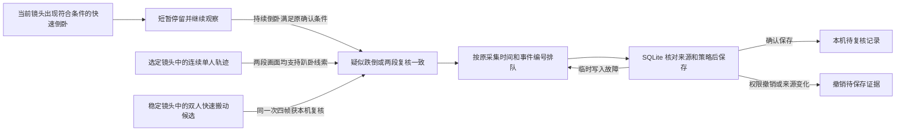

## 从镜头回看录像

镜头详情将镜头编号传给回看页。回看页沿用原录像目录和保护播放服务，查询时提交该编号和选定日期。服务核对已保存的录像来源与当前镜头来源。唯一的有效对应关系决定读哪个目录，配置缺失、来源变化或存在多条对应时提示核对设置。

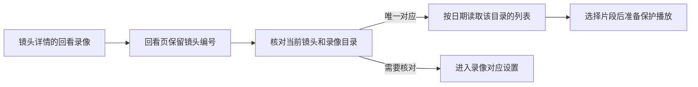

预览轮询、画面与停止凭据跟随当前镜头详情。退出详情时回收该预览。收到打开镜头的回执后，启动预览仍要求详情在当前页面打开。

## 游戏画面与关间衔接

滑雪的三条雪道由 `ski_route.py` 定义。游戏库通过 `GET /api/games` 读取雪道长度、门数和中心线。确认开局后，Console 将选定的 `ski_trail` 连同页面读回的当前游戏版本传给原 worker，并核对 worker 读回。游戏页只能用选择命令换道，开始命令沿用已选雪道，且仍须当前画面就绪。

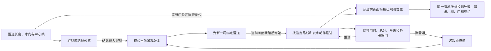

快照里的实际门宽受难度影响。`ski.route` 与 `ski.trees` 提供当前雪道的完整门位和碰撞树位，旧 worker 的可见树列表仍可用于绘制。舞台收到新观测时从当前绘制位置开始，最多用 120 毫秒抵达观测位置。暂停保留最后画面，长时间失去画面或进入新局时直接使用当前状态。计分仍由 worker 按观测位置判定。完成后汇总分段成绩和滑行累计用时，重滑时保留选道和难度。

双人网球按镜像视图的起始站位分配本局编号，并沿用同一组追踪槽位。站位等待时，`tennis.lineup` 按槽位给出就位、需站定、脚部出画或玩家出画的状态。`tennis.guide` 从击球规则读出当前接球人、落点、范围与难度对应的击球窗口，供同一个计分区和球场画面使用。

网球由 1 号发第一球，首分后换发，此后每两分轮换。`tennis.serve` 在等待开球时提供发球人和就绪状态。两人入镜且发球手停稳后，只有发球人的新挥拍会启动同一套飞行与回球判定。暂停或站位丢失会撤销就绪状态。球场、记分牌和可选击球声使用规则确认的发球事件。

游戏库的体感网球共用一个球场入口。详情选单人练习或双人对打后，`POST /api/embodied/start` 核对当前对局版本，再让 worker 在同一次选择中准备玩法和难度。worker 确认选择后，界面带着新版本打开舞台。继续本局使用已有版本，候场和结算仍可在球场切换下一局玩法。开始沿用同一玩法和难度，仍须当前画面就绪。单人局只接纳一位玩家的动作，陪练发球依次经过定点、左右和加速三组。九球逐一按真实球路与观察到的挥拍计入 `tennis.practice.results`，球场和进度使用同一快照。手脚出画时保留当前球，源恢复只要求一位玩家重新就位。重练清空本轮成绩。

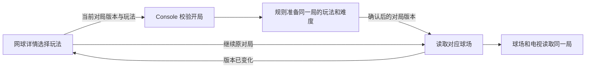

山径冒险与运动训练由 `BodyMotion` 提取可见关节的动作信号。单腿站立要求支撑腿伸直、另一脚抬起并稳定保持 1 秒。交叉触膝要求抬膝并用对侧手靠近。交替侧抬腿检查脚的侧向距离、离地与另一腿支撑，短暂停稳、回到站姿后计次。头顶合掌要求站稳、打开双臂、让手在头顶上方靠拢，再打开双臂。暂停、关节遮挡或丢失玩家会撤回尚未完成的新动作，已完成次数保留。“试一试”复用同一规则，单个镜头观察到完整动作后反馈成功。关卡和教学使用同一动作标识，减少动态效果时使用同源的定格图。

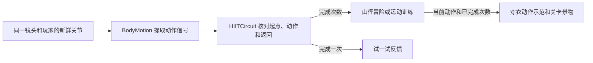

`MotionGames` 决定本局进度，`GamePresentation` 只接纳有界的画面可见性与素材就绪回执。同局同模式的相邻动作切换时，保留上一有效回执剩余的可见期限等待新画面；不延长期限、不继承素材就绪，也不推进动作或关间时钟。当前动作的示范已经挂载且素材可用后，页面才申报就绪。

新关已受理的可见或隐藏回执都会接管旧期限；关闭回执先于首次可见回执到达时，同样撤回继承资格。另一块当前已就绪的画面仍可维持游戏。没有有效画面时保留已赚进度，仍需原摄像头、玩家与来源检查，以及使用者明确继续。

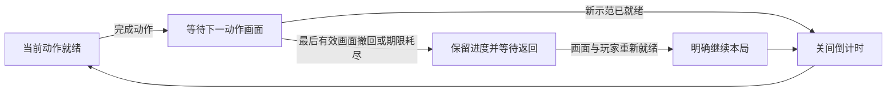

本轮没有新增显示协议字段或设备权限。原规则、API、合成关节及浏览器交互验证分别记录；这些结果不替代真实玩家、电视或声学验收。

## 狼人杀大屏入座

大屏读取房间快照后，在大厅有空座时凭现有大屏凭据请求 `GET /api/invitation`。局域网服务同时核对当前房间和来源。邀请只返回当轮大厅版本、房间号和手机入口的二维码。主持端和电视用同一入口生成二维码，手机按原有选座及入座请求取得自己的凭据。

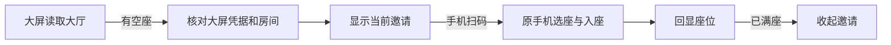

显示端在满座、发牌、页面离开或连接中断时撤回邀请及未完成的读取。恢复连接后再按当前大厅版本读取。二维码生成不可用时可用地址和房间号进入手机页。手机在原标签页复扫时先读取已有座位，凭据失效后打开当次邀请的选座页。

## 狼人杀发牌与首夜

主持端发牌后，规则进入无倒计时的认牌环节。手机用当前座位凭据读取自己的身份并提交当前版本的确认。每个座位只计一次，主持端和公屏读到的是已确认总人数。房间锁内确认全部座位完成后，主持端的下一环节命令才会进入首夜。

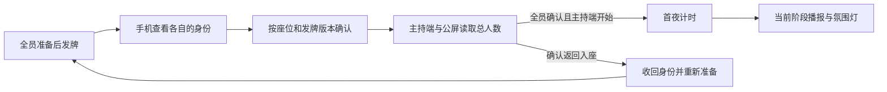

返回入座会收回原身份、清除准备与认牌状态，更新对局版本。主持端可移除无法恢复的座位，让玩家重新扫码。旧版本的确认不能计入新一轮发牌。认牌期间可以播报公共提示，夜间灯光从首夜开始切换。

## 狼人杀点名发言

选择自由发言时，可以在主持端点名、换人或结束发言。已对应座位的镜头举手提示会标在名单里。主持端发送当前房间、对局版本和请求编号，规则在同一房间锁内核对玩家仍在场，平票发言只接受平票座位。

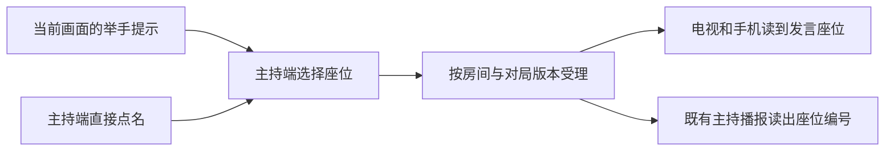

确认后的发言座位在镜头离线时仍由规则保留。暂停冻结本环节倒计时，恢复时回到原座位。换人不重置本环节时间，进入投票时清除发言状态。摄像头信号不提交投票。主持播报共用既有输出与静音设置。

开房可选择轮流发言。每个白天从顺延的起始座位轮流安排存活玩家，平票时只安排平票座位。规则给每位玩家 30 秒。手机通过 `POST /api/speaker-done` 提交当前版本，房间锁内核对本局座位凭据、发言座位与版本。一次换人更新一次版本。超时、主持端换人和手机完成使用同一条规则路径。暂停保留当前座位与剩余时间，再开一局沿用发言方式。

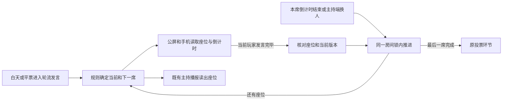

## 狼人杀断线恢复

`WerewolfService` 在房间锁内校验阶段版本和手机读到的选择版本。同一座位每次成功提交都会更新选择版本。
同编号同内容的重试先匹配原摘要并返回当前状态。已记录的请求不会因重试再次计入，
同阶段内迟到的旧请求也不能覆盖已更新的选择。

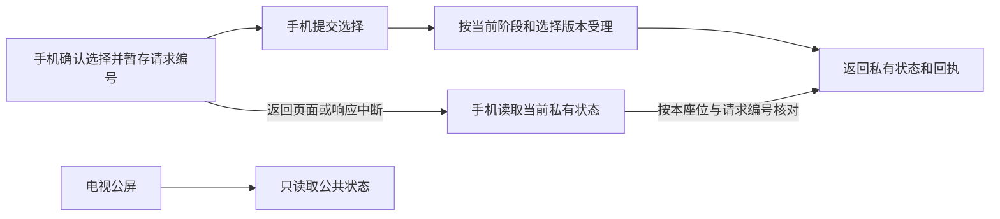

手机通过 `GET /api/player` 的 `X-Friday-Choice` 请求头查回执。未确认时由玩家重新选择并确认。
手机与大屏在同步期间隐藏旧倒计时。大屏保留座位和已经公开的投票结果，暂时收起主持提示及镜头提示，拿到新快照后继续显示当前环节。

## 狼人杀连玩

结束后，主持端的 `rematch` 在原房间开启空白的新局。它使用现有的房间锁、对局版本和请求编号校验，重复请求只回读当前状态。手机座位凭据、大屏地址、座位和昵称留在原房间，准备、角色、选择回执、票型和获胜方从新局开始。准备请求使用当前入座版本，阶段和播报编号在同一房间持续递增。

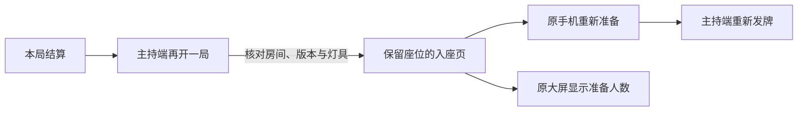

连玩先结束上一局的镜头占用，下一局用新上下文获取同源新画面。保留座位对应，提示仍须当前来源验证。若房间启用了氛围灯，先恢复上局灯光，再从相同设备绑定读取新一局的恢复基线。设备绑定变化或恢复失败时，留在结算页供主持人处理。
