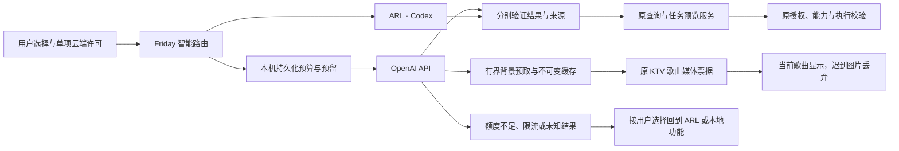

# Architecture

`homeplane/` is the current control plane; `friday/` retains the optional legacy
camera-oriented API. The default homeplane adapter is the explicit Simulator.
HA ingress reads states and area/device/entity registries. Action planning and
execution have separate capability, authority, freshness and idempotency checks.
Unknown results do not trigger blind retries.

The browser renders source-backed state and optional imported geometry.
`home_layout.py` validates and privately persists Mi Home imports.
`home_presentation.py` maps discovered functions to generic display styles.
`embodied/` owns optional camera workers, speech, gestures and bounded recognition;
it is not required to run the Console. Device discovery does not enable gestures.

The macOS shell is a client of a user-owned household service. Its private paths
are derived from the current user; it does not embed an author's repository path,
login session or signing identity. NAS and People content stay local. Optional
ARL provides the model-runtime boundary and is not a prerequisite for simulation.

## 可选择的智能增强

`intelligence/` 只产生建议、查询参数、语音转写和背景图片。`HomeQuestions`、任务草稿、
语音工作进程和旧版规划器复用统一路由，ARL 与 API 回执分别校验。查询授权、设备能力、
任务确认、幂等和实际执行仍由原服务持有。SQLite 账本用短事务在调用前预留预算；
网络调用不持有设备通用锁。失败不重放设备动作，未知云端消耗保留预留。

具体发送字段、用量口径、共享目录与未验证范围见[智能通道说明](intelligence.md)。
