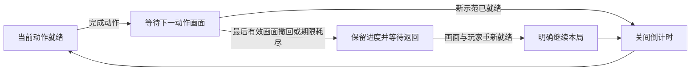

# Architecture

`homeplane/` is the current control plane; `friday/` retains the optional legacy
camera-oriented API. The default homeplane adapter is the explicit Simulator.
HA ingress reads states and area/device/entity registries. Action planning and
execution have separate capability, authority, freshness and idempotency checks.
Unknown results do not trigger blind retries.

The browser renders source-backed state and optional imported geometry.
`home_layout.py` validates and privately persists Mi Home imports.
`home_presentation.py` maps discovered functions to generic display styles.
`embodied/` owns optional camera workers, speech, gestures and bounded recognition;
it is not required to run the Console. Device discovery does not enable gestures.

The macOS shell is a client of a user-owned household service. Its private paths
are derived from the current user; it does not embed an author's repository path,
login session or signing identity. NAS and People content stay local. Optional
ARL provides the model-runtime boundary and is not a prerequisite for simulation.

## 游戏画面与关间衔接

`MotionGames` 决定本局进度，`GamePresentation` 只接纳有界的画面可见性与素材就绪回执。同局同模式的相邻动作切换时，保留上一有效回执剩余的可见期限等待新画面；不延长期限、不继承素材就绪，也不推进动作或关间时钟。当前动作的示范已经挂载且素材可用后，页面才申报就绪。

新关已受理的可见或隐藏回执都会接管旧期限；关闭回执先于首次可见回执到达时，同样撤回继承资格。另一块当前已就绪的画面仍可维持游戏。没有有效画面时保留已赚进度，仍需原摄像头、玩家与来源检查，以及使用者明确继续。

本轮没有新增显示协议字段或设备权限。原规则、API、合成关节及浏览器交互验证分别记录；这些结果不替代真实玩家、电视或声学验收。
