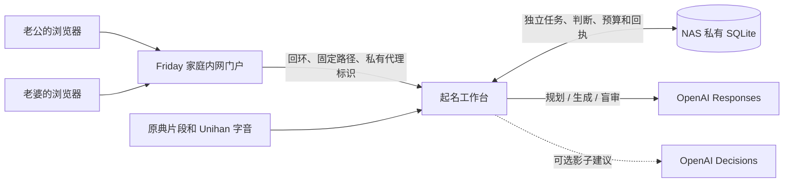

# 宝宝起名工作台的部署与搜索

工作台是 NAS 上的独立 Python 3.8+ 服务。使用标准库和 SQLite，不依赖 Friday 家庭控制或 HA。网页和服务都在 `/apps/baby-naming/` 下，现有内网门户只转发这一段。公开门户和默认公网入口不注册该路径。



## 运行

1. 在 NAS 的私有服务目录安装本模块，保留 `integrations/baby_naming`，以及 `homeplane/static/vendor/` 下已有的两份 Three.js 模块与许可。数据、代理标识和 API 凭据放在同目录下独立的私有子目录，权限分别为 0700 与 0600。用家庭服务的普通账号运行。
2. 在权限为 0600 的文件中配置 API Key。可读一行裸 Key，或 `OPENAI_API_KEY=…`，也支持 Friday 自有的私有 JSON 结构。进程只发往官方 OpenAI HTTPS 地址。选择具有 Responses 结构化输出权限的模型。每日尝试上限默认 24，北京时间零点重置，范围可设为 3–200。Responses 设置 `store:false`，用量和固定状态在本机保存。需要内网出网中继时，为本工作台显式设置 `--api-proxy http://内网主机:端口`。中继只接受指定 NAS 发往 `api.openai.com:443` 的 CONNECT，实际 TLS 握手、验签和凭据读取仍在 NAS。中继离线时可继续看已审核的名字和记录。
3. 将已授权的历史记录置于私有种子文件，包含姓氏、确认避字、来源明确的偏好线索，以及每条完整姓名的方向和两人的历史判断。首启用 `--seed` 导入，同一份种子重复导入幂等。原始资料不进入源码。真实旧记录先离线回放，真实 API 链路通过后再接门户。
4. 用服务账号持久运行下方命令，绑定 `127.0.0.1:19146`。门户只在经核实的内网入口为该段覆盖代理标识。修改门户前，从当前 NAS 内网文件读取内容和哈希，对照现有站点，再使用 `portal_update` 计划与应用。核实公开入口不会转发该路由或透传可伪造的来源标头。若门户位于 DSM 回环反代后，先只读确认公网与内网入口、正确的 LAN 网段，及代理确实追加或覆盖真实来源；通过 `--lan`、`--gateway-port`、`--trusted-proxy` 和 `--forwarded-header` 固定边界。门户只读取实际连接来源，或对受信任回环网关采用转发链最后一跳。
5. 在两台浏览器、家庭 Wi‑Fi、NAS 回环与公网入口分别检查。内网首页及工作台正常，直接回环请求缺少代理标识返回 404，第三方 Origin 的写请求返回 403。分别用两种角色验证异步恢复和共同确认。用户本人试用记录另行保留。

```sh
python3 -B -m integrations.baby_naming.service --data /private/names/replay \
  --seed /private/names/history.json --replay
python3 -B -m integrations.baby_naming.service --data /private/names/state \
  --seed /private/names/history.json --key-file /private/names/openai.env \
  --smoke girl --decisions-shadow
python3 -B -m integrations.baby_naming.service --data /private/names/state \
  --key-file /private/names/openai.env --origins http://friday.local \
  --proxy-proof /private/names/proxy-proof
```

`portal_update plan` 读取指定内网运行目录的 `server.mjs` 和 `index.html`，输出审核所需的哈希。应用需传入刚读回的哈希，校验现有路由锚点、回环服务、门户首页、应用路径和 Node 语法。NAS 的现有监督器只重启核明归属的门户子进程。失败时恢复当前任务的改动。回滚先核对已装文件及备份哈希，恢复入口并重启内网门户，再停止独立服务。家庭 SQLite 与历史输入保留。生产凭据不进入部署日志、门户文件、浏览器、公开仓库或源码包。

## 搜索和并发

历史明确否决进入精确全名规则，同时保留另一人的正向意见。单字偏好仅作为证据。传统取名五法用于取材，原文成词、两意相承、修饰、动作对象、借象成意用于双字组合。语料从 `corpus.json` 检索。同一历史全名不再发卡，男孩和女孩分别维护。

- **规划。** Responses 收到精简的已发布双人反馈、真实规则、最近搜索计划和统计；产出带证据编号的搜索假设和可能的比较轴。
- **后台归纳。** 两人已经共同看见的判断、共同完成的对照和主动提供的说明各有证据编号。三组新的独立名字证据、一项新的双人对照或新增的提名说明可启动归纳。同出处或共享给名字的变体合并；普通划卡后留出静默期，归纳每方向每天最多尝试一次，并给主动搜索保留三次请求。它由独立工作线程调用 Sol 高，保存两人的假设、反例、待验证动作和依据。撤销或改变判断后，证据指纹不符的假设跳过。主动搜索照常开始，有可用归纳就带入规划和生成。
- **造名。** Responses 从有版本的语料、规则与假设构思，每轮至多六项进入盲审。代码再核对全名格式、禁字、重复、历史否决及原文是否确有该词。独立读音库提供常见拼音作为盲审依据。
- **盲审。** Responses 只收到完整姓名、拟读音、客观来源和音读核验材料。生成者的推介文案、首看短句、排序和父母偏好不进入该请求。首看短句由造名阶段另行生成，固定长度与文案要求；出处标签取自已核对的证据。旧卡没有生成短句时使用已核对的出处或中性的用字提示。审查要求覆盖每个候选。读音无法确认的名字保留在待核验范围；只有通过才进入可展示队列。
- **派发。** NAS 固定每人当前组至多六个新名，按各自进度派发。新组依据两方的较低接受估计、构词多样性和探索位置排序。复看到期优先，有可用对照时才安排选择题。持续否定同一方向时，先按来源或用字合并近似变体；至少六条有效样本且接受率估计的 90% 上界低于 30% 才降权。复看修订原样本。双人各自确认一个名字后停止当前方向的发卡和未完成搜索。
- **异步。** 当前组的下一张普通候选可提前准备，直到 NAS 返回正式任务才启用操作。浏览器发出判断时立即播放离场动画；NAS 在同一事务中保存判断并确定下一项。到期复看或有用的比较可取代预备卡。任务有独立编号，身份和方向共同限定写入，同一任务的同一答复可安全重发。另一方未提交的首看、复看和对照结果不进入共同模型资料。生成任务并发合并、保留回执，断电重启后可按各自身份续接。

## Decisions 试点

默认的「6.1-Sol 高」在三阶段使用 Responses API 的 `gpt-6.1-sol` 和 `reasoning.effort=high`；「Luna 低」使用 `gpt-6-luna` 与 `reasoning.effort=low`。每个身份的设置存于 SQLite，保存立即生效，不重启任何服务。档位随新任务入库，已经排队或运行的方向不会被另一人或新设置改写。两档共用现有的每日请求次数上限，Sol 每个阶段有单独的输出和超时上限。Decisions 试点使用同一个模型标识，通过独立的 Decisions API 调用，未设置 Responses 的推理强度参数。生产默认关闭试点；本地规则继续派发。

[Decisions](https://developers.openai.com/api/docs/guides/decisions) 适合在确定的选项中分类。试点输入只包含「是否暂停、是否有到期复看、是否有明确对照、未看数量」，输出「闪卡、对照、复看、等待」及置信度，记录与本地基线的差异、延迟和用量。不开启时零额外 API 请求；开启也不改变实际派发，失败不影响已审核候选。等真实异步数据积累后，再比较每找到一个共同备选所需的额外操作和错误打扰次数。应先检查复看和对照的分歧样本，确认比规则有实质改善，再考虑上线。

[Unihan 17.0.0](https://www.unicode.org/Public/17.0.0/ucd/Unihan.zip) 的 `kMandarin` 用于校验常见读音。保留扩展 A 和基本汉字块，源 ZIP 的 SHA-256 为 `f7a48b2b545acfaa77b2d607ae28747404ce02baefee16396c5d2d7a8ef34b5e`。许可随表附上。该数据不是姓名登记许可或多音字专用辞书。
