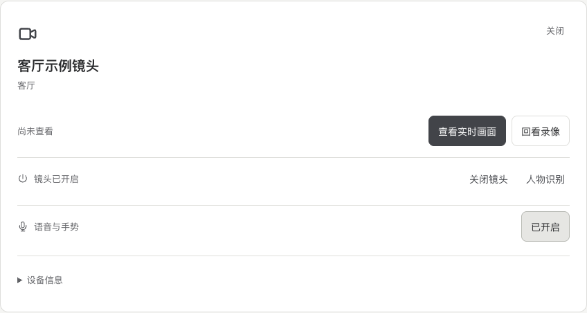
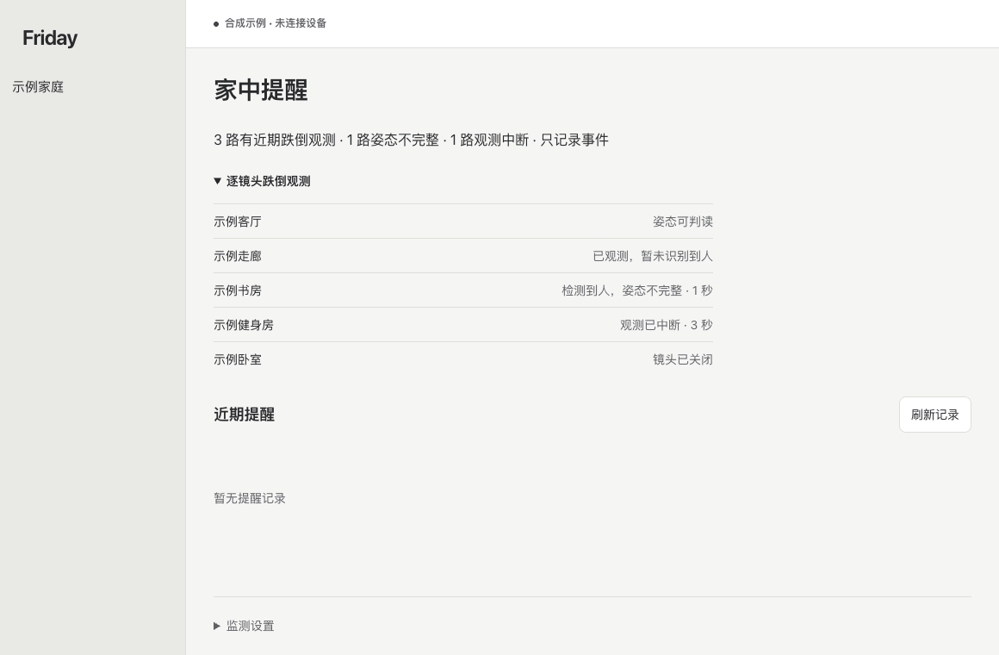
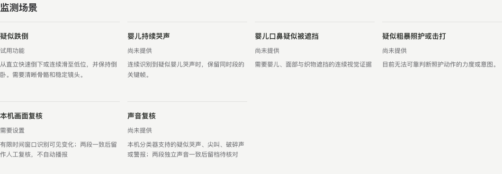
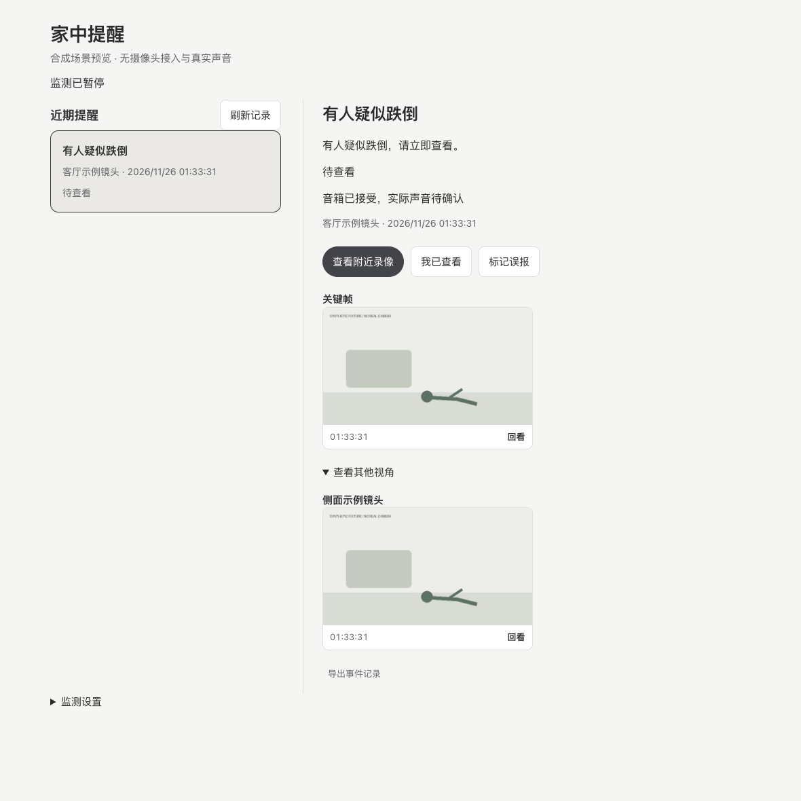
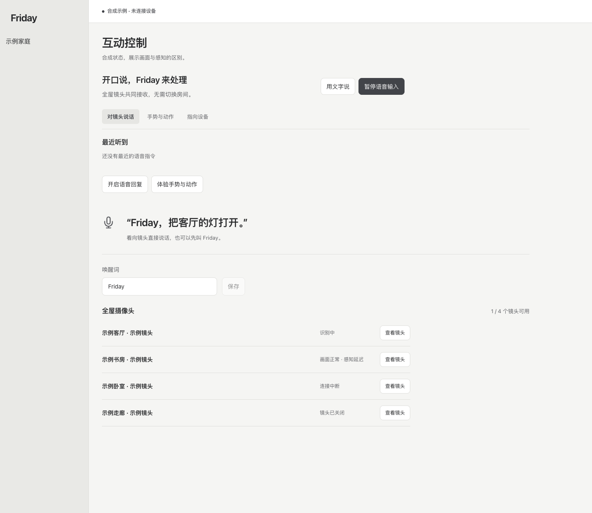

# 部署自己的 Friday

Linux x86_64 CPU 适配的独立环境、ARL 入口、验证范围和平台边界见[Linux CPU 运行时](linux-runtime.md)。

## 1. 基础控制面

安装 Python 3.11+、uv，克隆后运行 `./scripts/install-home.sh`。基础环境仅包含
Web 控制面与合成示例，不下载模型、Miloco SDK 或家庭数据。

`./bin/home doctor` 报告当前依赖与连接边界。`./bin/home serve` 在
`http://127.0.0.1:8740` 提供 Console。默认只读示例不能控制真实设备。

### 摄像头状态与间歇感知

在“互动控制 → 对镜头说话”查看全屋镜头状态：

- “识别中”计入可用镜头；“画面正常 · 感知延迟”表示仍有新鲜预览，但感知结果没有及时更新，暂不计为可用。
- 感知过期会撤下人数、动作与跟随锁定状态。其他镜头的自动巡视根据当前识别判断是否有人。
- “感知恢复中”表示识别程序正在恢复；“连接中断”或“画面已中断”且没有新鲜预览时，再检查摄像头连接。
- “镜头已关闭”保留用户的隐私选择。不要通过反复开关镜头或重启来掩盖感知延迟。
- 状态读取失败会撤下旧的可用读数。服务恢复后自动读取，页面刷新不代表镜头或感知已经恢复。

**怎样用语音唤醒镜头？** 开启语音控制后，说出设置里的唤醒词，默认是 Friday。自动跟随模式
下，收到唤醒词的镜头会根据当前画面确认人物，画面无人时短时查看两侧。看向稳定画面的镜头
说出指令时，Friday 也可以根据确认的注视接收。要使用已关闭的镜头，请先在米家打开它。
两台镜头同时收到同一句指令时，有效识别到注视的镜头可用自己的收音复核并接手。
转写有分歧时，可以对着镜头再说一次。
「对镜头说话」会从各镜头的最新反馈中显示最近三条，最新指令排在前面。

**喊完 Friday 还能接着说吗？** 可以。唤醒确认后，同一收音来源可接收六秒内开始的一句指令。
比如说「Friday」，停一下，再说「打开客厅灯」。云台转向时，仍有效的收音可以接收这句话。
自动巡视中收到确认的唤醒时，镜头稳定并取得清晰画面后就会开始找人。
刚恢复清晰视野时，镜头会先保持观察。跟踪短暂中断时，连续收到的清晰画面仍用于确认视野。
此时可以唤醒 Friday，镜头在取得新鲜的跟踪结果后可以继续转向。
若自动模式持续看到墙面，镜头会逐步调整俯仰并沿两侧搜索，每一步都等待新的画面。
多路镜头会轮流进行普通巡视。出现「保留当前视角」时，镜头正在保留有效画面，直至其他镜头稳定。
换到另一间房或镜头刚恢复连接时，重新唤醒或看向镜头说出指令。

**怎样指着设备说话？** 在「互动控制 → 指向设备」添加并启用绑定，选择镜头和设备并标记位置。
在该镜头的固定标定视角里，用食指指住这台设备片刻，说「Friday，把这个打开」或「关闭这个」。
确认注视时可以省略唤醒词。多人入镜时，先比 OK 选定操作者，再看向镜头说话。
支持调光且开启的灯可以说「这盏灯暗一点」或「这个亮一点」。读回设备状态后，同一镜头和操作者有
六秒可以继续引用这台设备，继续看向镜头说话或重新说唤醒词。镜头转动、指向不明确或设备离线时，
可以等画面稳定后重新指向，或直接说出房间和设备名称。

在“摄像头”选择一台镜头，可用详情中的“语音与手势”暂停或恢复这台镜头的互动。
实时画面、后台感知和镜头的隐私开关仍由各自设置控制。仅提供预览的镜头可在米家打开后查看。



**运动训练时可以保留窗帘手势规则吗？** 可以。进入体感游戏后，主镜头和同房间的副镜头暂停
设备手势。HIIT 等待、练习、暂停和结算期间，每路镜头都暂停用身体动作控制设备，
包括可能拍到训练区域的相邻房间镜头。家庭语音和其他房间的手形控制照常使用。
退出训练后，先放松，再重新做一次绑定动作。

同一位已登记成员的同一手势被多路镜头看到时，设备只收到一次指令。如果最先识别的镜头在发送前
掉线，另一路仍看到该手势时可以继续执行。

**为什么能看到画面，互动却时断时续？** 采集和感知分别计时。房间配准、
人物识别或隐私状态读回耗时较长时，感知结果可能超过原有 1.5 秒有效期。
过期结果不能用于动作或异常判断。处理方式是减少帧的等待和重复解码，保留
新鲜度门槛，并分别核对画面连续性、感知连续性和实际使用效果。

**怎样看出一台镜头还能否提供跌倒观测？** 在「家中提醒」展开「逐镜头跌倒观测」。
「姿态可判读」表示这次报告的人体有完整可用姿态。「检测到人，姿态不完整」表示有人的姿态无法完整判读。
「已观测，暂未识别到人」表示检测器处理了该帧。没有适用的新观测时显示等待或中断，镜头关闭单独显示。
当前视角中断后的恢复从新观测开始。姿态状态用于检查输入，识别和告警送达仍需分别验收。



**为什么听到疑似跌倒提醒时，关键帧可能还没出现？** 在「家中提醒 → 监测设置」启用语音提醒
并选择家庭音箱后，Friday 先保存已确认的提醒并准备播报。关键帧随后会写入同一条提醒，
可以在原详情中查看。发送前会核对当前监测授权和原视角中的新鲜倒卧观测。界面记录的是
播报请求及设备回执，实际听见的时间需要用家中设备验收。

**缓慢滑倒会留下提醒吗？** 同一稳定镜头需要看到站立时的双脚、连续下降及低位倒卧。
Friday 以原采集时间确认持续倒卧，并沿用当前提醒和回看设置。明显停在座椅上、躺到高处、
人物离开画面或镜头正在转向时，当前慢滑线索会结束。可在「监测设置」查看该试用能力。



**同一次疑似跌倒有多个摄像头拍到，在哪里查看？** 打开该条提醒并展开「查看其他视角」。
每个视角的关键帧和附近录像按自身来源和时间读取。「我已查看」和「标记误报」适用于整条提醒。
不同事件各自留档。如果音箱繁忙，可以先查看等待中的提醒。超出有效等待窗口会显示「等待超时，未播报」。



下图使用固定合成输入，不连接设备；参见[感知状态示例](../fixtures/homeplane/camera-perception.html)。



## 2. Home Assistant

优先复用已有 HA。首次启动桌面版会直接打开“连接你的家”；Web 示例首页和“连接”页
也显示同一清单。点击“查找并连接”：只有一个实例且只有一个地址时会进入它的登录页；
多个实例或地址需要选择。没有发现结果时可直接填写完整地址，不必编辑配置文件。
完成 Home Assistant 官方登录后，点击“连接并读取设备”。地址、授权、实际家庭读取
分别显示完成状态；服务离线时保留已有授权，可重试或更改地址。
纯 CLI 的只读接入可在本机设置 `HOME_HA_URL`、`HOME_HA_INSTANCE`、`HOME_HA_TOKEN`，
然后执行 `./bin/home --mode ha-read-only serve`。不要把真实 token 写入命令示例或聊天。

**HA 临时掉线时还能用什么？** 桌面后台保留已配置且开启的摄像头和它们各自的互动设置。
已核对独立米家授权的窗帘仍可使用，其他家电和依赖其状态的规则等待 HA 恢复。接回设备
状态后，从新的合格事件继续运行。摄像头、HA 和米家中枢各有自己的连接状态。

**米家中枢已连通时设备为什么还是不可用？** 中枢连接、目录和设备可控状态分别更新。
直连目录持续为空时，Friday 会用已有授权重新发现同一个家庭。固定版 SDK 收到设备上下线
通知、但目录查询暂时失败时，Friday 会在现有连接上重新读取目录。家庭规则和设备的绑定
会保留，目录恢复后更新可用路由，期间其他可用设备和控制渠道可以继续使用。

需要新 HA 时，在准备运行 HA 的 Linux 主机执行：

```sh
python3 scripts/setup-dependencies.py prepare
# 编辑忽略目录 data/deployment/.env 中的 TZ，选择自己的时区。
python3 scripts/setup-dependencies.py xiaomi-home
python3 scripts/setup-dependencies.py ha-up
```

生成的 Compose 固定 HA 版本，使用 host network 与私有持久卷；默认没有 privileged
权限或 USB/蓝牙设备映射。按实际硬件需求显式添加，不能据此声称无线设备已经可用。
首次打开 `http://<your-linux-host>:8123` 创建自己的管理员。HA Container 不含 Supervisor
或应用商店。官方安装要求 Docker Engine；macOS 应使用 Linux VM/独立 HA 主机，
不要把 Docker Desktop 的网页可访问误认为组播/蓝牙完整兼容。

`xiaomi-home` 安装 Xiaomi Home v0.5.0，校验官方提交
`75b3acb6325a3a8d295688b13904737d6738a6a5`，使用独立版本缓存；已有集成不覆盖。若 HA
已经运行，重新启动 HA，在 设置 → 设备与服务 → 添加集成 → Xiaomi Home 完成官方
登录，选择你的区域、家庭和设备。账号选择和设备授权只能在上游页面完成。

停止新建的实例：`python3 scripts/setup-dependencies.py ha-down`。保留持久卷；不删除
用户数据。日常启动不会自动更新依赖。

### 已有 Xiaomi Home 的离线升级

v0.4.3 的云设备刷新在网络异常后可能不再重试。官方 [#1555](https://github.com/XiaoMi/ha_xiaomi_home/pull/1555)
在 v0.4.6 加入异常后的重试；本脚本固定的 [v0.5.0](https://github.com/XiaoMi/ha_xiaomi_home/releases/tag/v0.5.0)
包含该修复。不要把网络恢复或 HA 网页可打开当作设备状态已恢复。

先暂停互动，在 HA 仍运行时记录当前实例的精确容器标识，并准备来源：

```sh
python3 scripts/setup-dependencies.py xiaomi-home-source
```

正常停止 Friday 与同一台 HA，备份该 HA 完整 `/config`（包括 `.storage`）和 Friday
私有配置。确认容器已停止，再执行下面的升级命令；将示例变量设为已核对的容器标识：

```sh
python3 scripts/setup-dependencies.py xiaomi-home-upgrade --ha-container "$friday_ha_container"
```

Linux 的 Docker 需要 sudo 时，先 `sudo -v`，再追加 `--docker-sudo`。
非默认源码或 Docker 路径可用 `--project`、`--directory`、`--docker-executable`。
升级只适用于私有部署目录下的本地 bind mount；其他 HA 安装方式按原维护入口处理。
脚本会核对容器已停且 `/config` 指向当前目录，完整暂存新集成，并将旧组件保留在
`data/deployment/integration-backups/`。替换文件失败时恢复原组件；启动后的版本迁移
若需回滚，应在再次停机后恢复完整 HA 备份，不能仅换回 Python 文件。

重新启动 HA 与 Friday 后，核对集成版本和加载状态、原实体标识、规则、控制范围、
绑定设备正常且未过期的状态、摄像头及原暂停设置。通过后才恢复互动并由使用者验证
实物动作。依赖安装、服务启动、设备状态和物理效果分别记录。

依据：[HA Linux 安装](https://www.home-assistant.io/installation/linux/)、
[HA Container 维护](https://www.home-assistant.io/common-tasks/container/)、
[Xiaomi Home 安装与隐私说明](https://github.com/XiaoMi/ha_xiaomi_home)。

## 3. Miloco（可选）

Friday 基础运行不依赖 Miloco。摄像头能力需要账号、设备支持、SDK/媒体协议以及
独立安装的上游服务；不是安装 Friday 后自动开启摄像头。

“连接”页的“摄像头与互动”单独标为可选，不阻止家庭设备连接。安装与授权入口直接
可见。已有旧版兼容服务的用户可在“设置摄像头连接 → 已有兼容的 Miloco 服务？”中
填写地址并检查服务与米家绑定；这项检查不取流或开启识别。当前 Miloco 插件按下方
官方平台指南安装，不能把旧版 HTTP 服务配置当作当前插件已经接入的证明。

```sh
python3 scripts/setup-dependencies.py miloco-source
```

此命令仅克隆固定版本到 `data/upstream/miloco`，不执行安装器。让 Agent 读取其中的
`scripts/install-guide.md`，再按自己的平台读取 OpenClaw 或 Hermes 的完整指南。
Miloco 当前安装入口只支持这两个平台；Codex 可以协助部署这些平台，但不能把自身
声称为已支持的 Miloco plugin host。依官方固定版本 Release 安装；在其本机 UI 登录。
不要把最新版脚本直接当作已审计固定版本执行。

上游版本：[Miloco v2026.10.16](https://github.com/XiaoMi/xiaomi-miloco/tree/v2026.10.16)、
[固定版本安装入口](https://github.com/XiaoMi/xiaomi-miloco/blob/v2026.10.16/scripts/install-guide.md)。

控制面可选的媒体解码依赖：`uv sync --locked --no-dev --extra camera-media`。
原生 SDK 不打包到本仓，按上游许可证及平台限制安装。不要将旧版本 SDK 的一次成功
扩展为新版本兼容性保证。`homeplane/embodied/runtime-manifest.json` 仅是可选组件的
版本/摘要参考，不是已经安装或授权的证明。

## 4. 设备、房型、Agent

Friday 从当前 HA 注册表读取稳定 ID、区域、实体和服务能力，不要求特定品牌型号。
多个同名对象需要明确选择。MIoT 原生扩展按已导入 spec 的属性 URN 解析 SIID/PIID；
缺少/歧义/未知规格不发送猜测指令。HA 控制路径不依赖该原生扩展。

[房型导入](layout.md) 使用你自己的米家导出，默认不包含房型、方向或设备坐标。
可选 ARL 只连接你自己的实例；`scripts/install-arl-sdk.sh /path/to/ARL` 安装本机 SDK。
ARL 不属于基础依赖，缺少可信身份/任务契约时模型功能明确不可用，确定性控制可独立运行。
桌面应用会向既有 ARL 注册名称、图标与场景，并维持会话；注册本身不运行模型。
应用平台版本要求、场景套餐及界面连接字段见 [ARL 应用会话](arl-application.md)。

摄像头、人物识别和动作实验主要面向 macOS，并需要独立的本地模型、原生构建和 SDK。
`uv sync --locked --extra vision --extra camera-media` 只安装声明的软件依赖，不下载
模型或获取授权。`python3 scripts/embodied/runtime.py --check` 列出缺失输入，
`--build-native` 编译当前主机的 Vision worker 与摄像头 socket helper，不安装或启动它们。

可选声音复核使用 macOS SoundAnalysis，不下载第三方声音模型。源码部署可通过
`python3 scripts/embodied/runtime.py --build-sound` 显式编译到本机可选运行环境；编译
不会开启摄像头、声音输入或运行分类器。随后在“家中提醒 → 监测设置”开启声音复核。
首次处理已授权镜头的声音时，才核对系统分类器实际提供的类别。构建中间文件使用
用户指定的 CodexBuilds.noindex 缓存；声音原始数据只在有界内存中处理。

可选的 [本机画面复核](local-video-review.md) 使用独立、按需加载的 MLX 子进程。
默认关闭，不随基础部署下载模型或开启监测。

## 5. 验收顺序

依次记录：基础服务健康 → HA 登录 → 当前注册表读取 → 自己的户型导入 →
单设备动作预览/授权 → 实际用户确认 → 可选摄像头/音频/模型。发现、注册、HTTP200、
ACK、playing 或帧数都不能证明物理效果、音画同步或识别准确率。

## 6. 设备控制权限

HA 登录与读取成功不会自动授予 Friday 设备写入权限。首次连接可以先查看状态；
控制范围由本机操作员单独设置，不能通过登录回调或发现结果扩大权限。

本机操作员应根据当前 HA 注册表与设备能力，审阅 `HomeDeviceAuthority`
（`homeplane/action_contracts.py`）的目标实例、操作范围、可选实体限制与有效期，
再将授权保存在忽略的私有目录。Web 服务使用其配置目录下的 `action-authority.json`；
桌面版使用其私有 embodied 目录下的 `private/action-authority.json`，配置后重新连接。
不要复制其他家庭的实例或实体标识。授权文件不是 HA 令牌，不需要在聊天或公开仓库中提交。
已授权的控制可以在“连接 → 高级连接设置 → 家庭数据”中暂停或恢复；暂停不会撤回已发送的指令。
