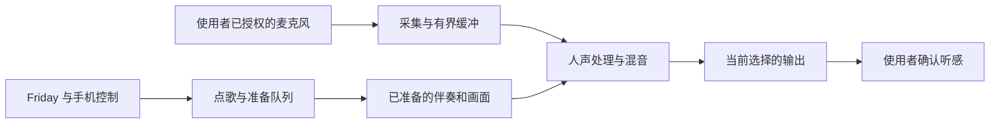

# KTV 音频路径与延迟验证

音频体验需要同时核对采集、处理、输出和实际听感。服务启动、缓冲统计、厂商接口返回与播放状态只能说明各自的阶段，不能作为已经出声或低延迟的结论。

## 路径与职责

Friday 的控制端负责点歌、准备状态和队列；电视端负责已配置的麦克风、伴奏、效果和输出。普通声音路径与可选的厂商适配路径分别验证，不根据设备名称推定底层能力。驱动、来源和能力不能确认时，保留普通路径或明确等待配置。

具体实现和构建入口见 [KTV 开发说明](ktv-development.md)、[电视音频源码](../native/KTVTV/) 与 [服务源码](../homeplane/ktv_service.py)。家庭实测原文、设备标识和恢复记录保留在本机私有验证材料中。

## 验证顺序

1. 核对当前采集与输出设备、授权、格式和真实连接，不按厂商品牌匹配目标。
2. 单独确认原声、伴奏和最终混音可闻；记录是否出现失真、反馈、丢音或路由变化。
3. 在明确授权后使用已知参考声测量完整回路，说明测量覆盖的输出、空气、输入及处理区间。
4. 分开报告处理时间、缓冲时间、交付间隔与实际声学结果，不能将软件计数换算成未经测量的口到耳延迟。
5. 停止后回读采集、输出和可选适配状态，确认本轮资源释放，并保留必要恢复记录。

改变采样率、增益、效果或路由时，每次只改变可归因的变量，重新确认实际声音。单次硬件结果不能扩展为所有电视、音频设备和房间的性能结论。

## 当前交付边界

源代码、协议测试、合成媒体检查和 App 构建各有独立回执；真实电视部署、稳定演唱、声音效果、声学延迟和恢复仍需单独验收。本文不发布家庭设备清单、现场操作流水或未完成的厂商实验记录。
