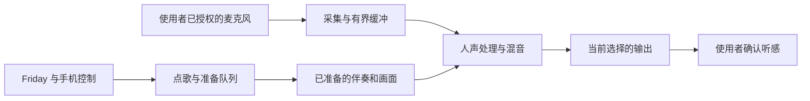
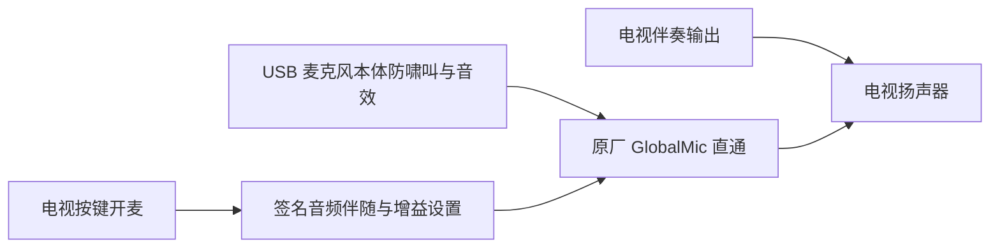

# KTV 音频路径与延迟验证

音频体验需要同时核对采集、处理、输出和实际听感。服务启动、缓冲统计、厂商接口返回与播放状态只能说明各自的阶段，不能作为已经出声或低延迟的结论。

## 路径与职责

Friday 的控制端负责点歌、准备状态和队列；电视端负责已配置的麦克风、伴奏、效果和输出。普通声音路径与可选的厂商适配路径分别验证，不根据设备名称推定底层能力。驱动、来源和能力不能确认时，保留普通路径或明确等待配置。

具体实现和构建入口见 [KTV 开发说明](ktv-development.md)、[电视音频源码](../native/KTVTV/) 与 [服务源码](../homeplane/ktv_service.py)。家庭实测原文、设备标识和恢复记录保留在本机私有验证材料中。

厂商低延迟路径的内联处理依赖通过实机握手的厂商音频桥。支持同流处理的桥会在原输出块执行陷波、人声效果与限制峰值，干声保持原输出流。严重保护事件或保护观察失联时，伴随组件立即撤销该输出租约，并随后核对硬件停止回执。恢复需新的手动开麦。

原厂直通接收 USB 麦克风输出的人声。电视核对原厂协议、唯一 USB 输入和实际输出路由，使用 GlobalMic 返听。原厂 START 会先以默认增益开启 PCM，应用在启动回读后应用用户的人声音量。一次开麦操作完成这组调用。控制进程退出或换路由后，伴随组件发出 STOP 并在回读后释放零样本载流轨。

电视诊断提供只读的音频桥状态，区分监听器无响应、访问被拒绝、协议验证失败、框架控制路径不一致与伴随组件验证失败。检查状态时不启动录音或输出流，只上报固定类别。

标准路由优先打开经路由核验的 Oboe/AAudio 声道，共用软件防啸叫与伴奏混音。软件保护从新的连续输入形成约 43 ms 的分析窗口后才开放返听。缺帧时关闭人声并丢弃未完成的分析窗口，保留已应用的保护限额和静音锁定。返听开启后处理当前音频块，分析窗口不增加干声队列。单声道持续削波和任一立体声通道持续削波都可以独立触发保护。

## 验证顺序

1. 核对当前采集与输出设备、授权、格式和真实连接，不按厂商品牌匹配目标。
2. 单独确认原声、伴奏和最终混音可闻；记录是否出现失真、反馈、丢音或路由变化。
3. 在明确授权后使用已知参考声测量完整回路，说明测量覆盖的输出、空气、输入及处理区间。
4. 分开报告处理时间、缓冲时间、交付间隔与实际声学结果，不能将软件计数换算成未经测量的口到耳延迟。
5. 停止后回读采集、输出和可选适配状态，确认本轮资源释放，并保留必要恢复记录。

改变采样率、增益、效果或路由时，每次只改变可归因的变量，重新确认实际声音。单次硬件结果不能扩展为所有电视、音频设备和房间的性能结论。

## 当前交付边界

源代码、协议测试、合成媒体检查和 App 构建各有独立回执；真实电视部署、稳定演唱、声音效果、声学延迟和恢复仍需单独验收。本文不发布家庭设备清单、现场操作流水或未完成的厂商实验记录。
