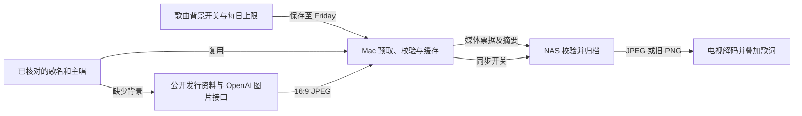
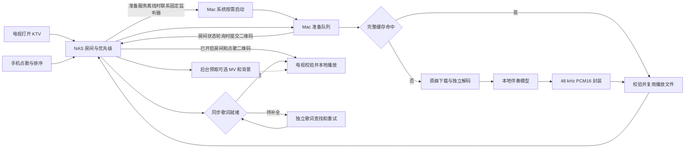
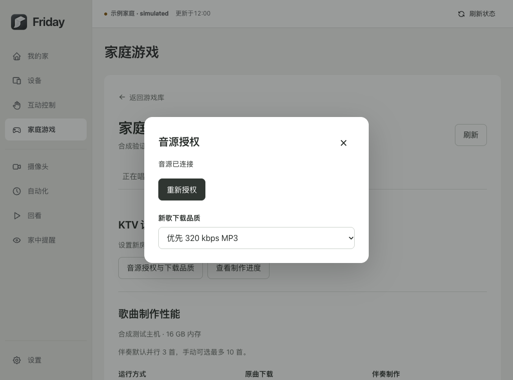
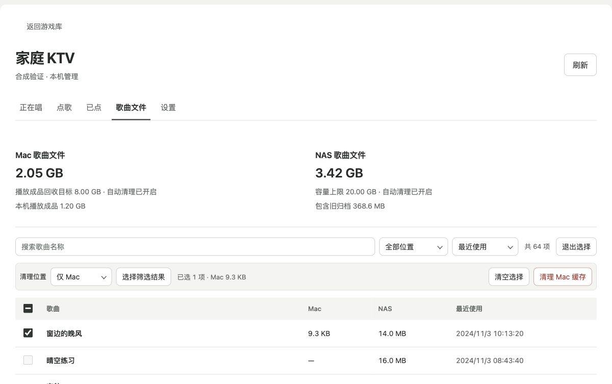

# Friday KTV

## 歌词补全与逐曲背景

公开曲库歌曲排到前列时，Mac 先查同一曲库标识的同步歌词。已验证的原曲和伴奏可以先交给 NAS 归档，
电视在歌曲具有匹配歌词后才开始演唱。歌词待补全时，其他已经就绪的歌曲可以继续准备和播放。
云盘上传文件内嵌同步歌词时，优先从核验过的原音频读取。缺少内嵌时间轴时查上传版关联记录、公开曲库和
歌手目录。同步歌词为空或候选时间轴冲突时，Friday 使用现有 OpenAI 配置补查。初次匹配不到公开录音时，
用歌名和歌手找候选，再核对曲库录音身份和实际音轨时长。上传文件、账号和路径留在本地。
暂时查不到时后台重试，其他已就绪的歌曲照常切换。若仍没有匹配版本，手机的歌曲操作提供「找其他版本」。
NAS 已归档的音轨可补查歌词，无需重复制备伴奏。

在「家庭 KTV → 设置 → 歌曲背景」开启「启用 AI 歌曲背景」。Mac 在后台优先补齐当前和接下来的歌曲，再处理已制备的缓存。
直接从 NAS 回档的歌可复用既有背景。曲库、云盘及同歌手的现场版可按核对过的歌名和主唱共用背景。
无公开曲库匹配的云盘曲目也可用显示的歌名与歌手补查发行资料。资料有限时使用抽象美术，
优先让曲风和可核实的题材决定意象、用色及表现媒介。画面左侧给歌词保留连续的低细节空间。
图片以 16:9 JPEG 交付，保留原图的色彩和亮度。电视使用文字阴影与左侧渐隐改善歌词对比。
图片生成与传输在独立队列中运行，未就绪时显示本地主题。每首作品同一时间只生成一张背景；
手动重新生成会更新这首作品所有版本共用的背景。
NAS 校验媒体票据对应的图片并归档，电视核对摘要、尺寸和当前歌曲后再显示。图片纳入 NAS 与电视的媒体清理。预算及缓存说明见
[智能通道](intelligence.md)。

当前配置使用已支持宽屏尺寸的 GPT Image 模型时，新背景直接请求 3840×2160，验证服务返回的实际像素后交付给电视。这一尺寸在 OpenAI API 中属于实验能力。只有接口明确拒绝尺寸参数时才依次尝试原生 2560×1440 和旧版 1536×1024。旧版仅裁为 1536×864。已缓存的图片继续按原尺寸使用。[OpenAI 图片生成尺寸说明](https://developers.openai.com/api/reference/resources/images/methods/generate#images-generate-body-size)

Mac 校验高分辨率 JPEG 的尺寸与完整性，直接保存返回字节。NAS 使用媒体描述中的格式返回相同文件，电视 0.74 起直接解码 JPEG。旧版 1536×1024 输出裁成 16:9 后编码一次；以前缓存的 PNG 继续使用。尺寸参数被明确拒绝时释放对应图片额度，JPEG 不受文字与语音请求次数上限影响。



电视负责本地歌曲播放、歌词、静音 MV 和氛围音。Mac 负责伴奏制作及热缓存；NAS 负责长期媒体归档、扫码入房、搜歌和房间控制。

## 使用流程

结束本场后重新开房间时，本场歌单、播放指针和已唱记录清空，准备好的文件缓存保留。重启应用连接当前有效房间。电视空场显示大二维码，歌单或播放画面右上角保留小二维码。手机扫码后自动加入。首次进入时随机分配昵称和头像，可自行修改。同一浏览器使用同一访客网址时，重新扫码会沿用已保存的昵称和头像。

启用 NAS 协调的家庭使用电视专用 NAS 连接。电视保留原 Mac 地址的情况下，先安装预置同一家庭 NAS 配置的私有升级包，或在遥控器菜单的“连接设置”更新连接。此后打开 Friday KTV 会向 NAS 开启或接续本场，NAS 会尝试拉起已配置的 Mac 歌曲准备服务。Mac 需要在线，休眠或断电时请先唤醒。

电视启动后先连接房间，二维码在连接成功后立即出现。Mac 和 NAS 的准备检查在后台进行，电视显示当前阶段；准备服务暂时离线时仍可扫码。服务暂时无法开房时，前台电视会继续用同一个请求间隔重试，也可选“重试连接”立即检查。需要更新连接设置时，电视会提示相应操作。

电视可用遥控器打开“房间设置”并选择“黑屏调试”。画面全黑，电视和房间连接仍保持开启。歌曲播放暂停，等待中的播放操作不会在退出时补执行。按返回或确定恢复画面，再手动开始播放。

手机负责搜索、点歌、查看准备阶段、播放／暂停、从头重唱、切歌、歌曲声音和排序。每首显示点歌人。歌曲操作里的「置顶」把歌曲放到待唱队首；「现在唱」才会切换当前歌曲。拖动手柄可以连续跨过多首，键盘可使用方向键或 Home。多人修改队列使用修订号检查，冲突后刷新，避免覆盖他人的新歌曲。

首页将搜索入口和「常唱歌曲」放在同一行，下方可浏览常唱歌手和公开歌单。「常唱歌曲」汇总这台手机点过且电视已开始播放的曲库歌曲与 MV，按播放次数排序，次数相同时最近播放的靠前。昵称默认使用三到四个汉字。云盘目录仅对已加入当前场次的访客开放。


更换搜索词会立即清除上一组结果。新结果带封面，滚动前预取下一页。在搜索标题栏可通过「已点」返回歌单。「接下来」和电视切歌使用同一份可唱顺序，准备中和未就绪的曲目单独显示。缺少同步歌词时后台尝试补全，仍缺歌词的版本在手机端「暂不可唱」分组中显示。唱过或切过的歌曲可直接“再唱一遍”。

NAS 协调模式在暂停、普通跨天或重启后接续本场。连续三天没有演唱或点歌时自动开启空歌单，正在演唱时继续保留。电视上选择「结束本场」后，下次开启会创建新场。已制备的歌曲文件可以在新场次复用。打开手机点歌主页或旧二维码时，页面会自动加入当前生效的房间。尚未开场时，页面等到开场后自动加入。

三种风格在手机房间设置切换，电视同步。可靠对齐的 MV 全屏静音播放，歌曲音频单独播放；没有 MV 或匹配失败时使用所选背景与歌词。电视主画面没有搜索、音量滑块或调试按钮，维护入口在遥控器菜单。

新房间先显示点歌页面，按「播放」开始。有待唱歌曲时，电视优先播放已具备原曲、伴奏和同步歌词的点歌曲目；同一批暂未准备好时显示当前进度。点歌队列为空时才会从完整缓存中选暖场曲目。电视遥控器 ↑ 切换原唱／伴奏、← 重唱、→ 切歌；弹窗内保留方向键导航。

MV 和静态歌词画面均显示五秒开唱倒计时。已有分离人声或严格对应的原曲／伴奏差分用于确认歌词附近的人声入口；噪声、串音或缺少缓存时保留同步歌词时间，不把能量检测当作逐字对齐。歌词中的制作署名不会作为开唱入口。这项分析只读歌曲缓存，不录制麦克风，不启动新的分离模型。

## 音源与准备流水线

NAS 搜索直接访问固定网易云元数据入口，不经过 Mac 的 ARL。Mac 主动轮询 NAS，不向公网暴露 Mac 管理密钥或家庭设备接口。



默认原曲下载、伴奏分离、播放文件封装均为 3 路，交叠运行。房主可在后台设置并发，范围分别为 1–3、1–10、1–4，设置保存到私有运行目录。背景生成另用 10 路，以 Friday 的 API 每日额度为准。系统按可用内存逐个启动分离任务；每个阶段按演唱顺序安排尚未开始的任务，减少并发或调整顺序会在现有任务完成后生效。

KTV 设置中的「音源授权与下载品质」默认优先下载 320 kbps MP3。同一歌曲的高品质完整音源不可用时，自动尝试 128 kbps。也可直接选择 128 kbps。设置用于后续下载，已有归档继续复用。模型处理固定采样率 PCM，电视混音统一为 48 kHz PCM16。



正式下载入口为 Mac 本地接口适配器，使用固定版本 `@neteasecloudmusicapienhanced/api` 4.41.1 的窄 stdin/stdout 桥，不启动该库的通用 HTTP 服务。只允许登录状态、歌曲详情和正式下载 URL 等固定操作；没有任意 URL 或方法调用。客户端下载 URI 已从运行服务中禁用，既有 NCM 文件仍可离线校验复用。

Friday「家庭 KTV」和兼容的本机 `/console` 均在当前设置页上显示音源授权弹窗。打开弹窗时读取现有授权状态。点击「打开网易云官方登录」或「重新授权」后，由用户在官方窗口完成认证。可用右上角关闭按钮或 Esc 返回原设置位置。官方窗口只保存下载所需 Cookie 到 `source-account/session.json`（0600），不读取浏览器或原客户端现有凭据。接口二维码遭风控拒绝时停止轮询，不反复重试或伪装环境。登录成功和真实新歌下载分别验收。

下载接口只接受账户允许的完整歌曲，拒绝试听信息、空 URL、身份不符或下载权限拒绝。下载限制到固定官方 CDN，禁用重定向及环境代理；精确检查歌曲 ID、响应字节数、MD5、解码时长及完整解码，再交给模型。签名 URL、Cookie 不回传手机或日志。不同歌曲并行下载，同曲通过锁合并；完整文件缓存经 SHA256 复核后复用。不会自动购买或调用 MV 扣点接口。

8 MiB 以上的完整原曲使用四路 Range 读取，适用于公开曲库和云盘原文件。CDN 忽略 Range 时接收其完整响应。传输阶段按连续无进展时间判断超时，持续收到数据时继续完成下载；完整原曲到达后，解码校验独立计时，成功后沿用原有缓存和 NAS 归档链路。

任务保留有界阶段日志，包括时间、阶段和固定错误码；不记录凭据、完整 URL、原始人声或自由格式上游错误。手机显示真实阶段、完成步骤和下载进度；内部等待原因和处理时间仅在房主管理页显示。没有可靠字节总量时不伪造百分比。失败任务提供有上限且幂等的显式重试。

## 长期归档与热缓存

使用者在私有 `data/ktv/archive.json` 指定已经挂载的 NAS 根目录。原曲、伴奏、播放 PCM 与 MV 归档到不公开的媒体目录；原始人声从不写盘。每次归档均采用临时文件、SHA256 回读和原子发布。NAS 未挂载时保留 Mac 文件等待重试，不会在同名本地目录创建伪 NAS 归档。

再次点歌优先复用已校验的 Mac 热缓存和 NAS 成品。从已挂载的归档恢复时按对应版本实际字节预留空间。新制备按 Mac 可用空间与并行工作预留准入。空间不足时显示「等待 Mac 缓存空间」，后台尝试回收并在一分钟内自动重试，其他能继续的歌曲照常制备。

Mac 默认保留 2 GiB 播放热缓存。超过预算时优先回收最久未使用、且已在 NAS 核对对应成品的本机副本。正在准备、归档、本场待唱和正在演唱的内容受到保护。制备完成即清理本任务生成的中间文件。长期保留的成品继续由 NAS 保存；完整 NAS 命中可直接使用已制备内容，省去下载和模型分离。

管理页分别展示 Mac 和 NAS 用量。歌曲存储提供批量选择，可删除仅 Mac、仅 NAS 或两端的受管理原曲与全部加工文件；具体范围与保护规则见下方“KTV 控制后台”。

「歌曲文件」在 Mac 制备服务内预先整理清单，桌面按页请求。搜索、存放位置和排序针对整个清单，批量选择可跨页。清单更新期间会保留上次读取的页。删除预览和提交分别核对所选文件和当前使用情况。

开场前的批量预制使用同一套下载、伴奏、同步歌词和歌曲背景流程。制备好的歌曲可以直接存入 NAS 曲库，当前房间的歌单和播放位置独立保留。任何房间再次点到相同音源版本时，可以在 Mac 离线的情况下读取已就绪的 NAS 成品。

配置了同一私有 NAS 挂载下的 `coordinator_media_root` 时，新旧归档可复用同一个播放 WAV。清理前核对两侧文件的 SHA256 和现用归档里的歌曲关联。旧清单仍按摘要读取同一份 WAV，电视继续使用原来的 48 kHz 双轨文件格式。


## 控制与播放

手机将“搜索点歌”和“已点”分为两个主视图；搜索显示是否已点，歌单按正在唱、接下来、唱过了组织，切回搜索保留输入和滚动位置。重唱使用图标，位于切歌左边；下方保留“歌曲声音”和“氛围”入口。鼓掌、喝彩、停止使用固定命令和独立音量；声音素材随电视 APK 离线提供，不接收外部媒体地址。

电视按方向键立即应用原唱／伴奏选择，网络回写在后台完成。手机→NAS→电视的控制轮询与下载、歌词、导唱制作分离；控制周期 150 ms、等待确认的手机刷新 125 ms 是调度参数，不代表已测得端到端响应时间。停止等待不被上一条声音的播放回执阻塞。过期、旧房间、旧请求和旧重试结果都不能覆盖当前操作。

两条已校验的 WAV 在歌曲准备时同时就绪。切换只在当前帧位置做 5 ms 交叉淡化，不重建音频引擎；启动窗口的最后一次选择也会保留。重唱复用已验证的本地音源与视频，避免重新经过下载锁。重启恢复有效房间和暂停状态。

氛围命令 5 秒后过期，仅最新一项交付。AudioTrack 写入或命令收到不代表出声，播放头推进后才上报 playing；停止、换房和后台会释放。常用素材来源、作者、CC0 授权与转换后的精确 SHA256 记录在 native/KTVTV/dependencies/sfx.json，发布扫描只放行这些字节。

## 手机交互

搜索页在标题栏显示已点数量，点击直接打开歌单。音源选项下直接显示歌曲，首屏先出现歌名和点歌按钮，缺少的曲库封面在后台分批补齐。滚动接近列表末尾时加载下一页。加载失败时会自动重试，也可在结果末尾手动重试。切换查询、音源或离开搜索页会取消旧请求，短时间内重复搜索复用已返回的页面。

当前与待唱歌曲的搜索行显示勾选且禁止重复点入；已唱和切掉的歌曲可再次点入。服务端事务负责多人同时点歌去重。

同步歌词查找结束后仍无可用结果的版本保留在「已点」，显示在「暂不可唱」。后面就绪的歌曲可以先唱。手机与电视从 NAS 读取同一版本的歌词状态。

手机底部控制条保留开始／暂停、重唱、切歌、歌曲声音和氛围。在“歌曲声音”可切换伴奏或原唱、调整歌曲音量和开启耳边伴唱。手机到房间的连接超时和电视控制回执延迟分别提示。

网络操作显示简短状态，不改变按钮占位。切歌等待匹配的电视播放状态，重唱还要求时间轴回到开头；命令序号只证明收到。歌曲音量等待电视应用的控制修订号；HTTP 写入串行，电视确认异步等待。超时不自动重复切歌。减少动态效果偏好使用静态环与文字。

搜索使用现有 NAS 结果接口；补封面使用当前房间已加入访客可用的 `GET /api/rooms/{id}/artwork`。该接口只查询有界数量的公开曲库标识，共用 NAS 的封面缓存，不查询云盘目录。封面查询与搜歌并发配额独立。

耳边伴唱为当前场次的访客提供已校验的原唱音轨。电视继续播放伴奏，手机跟随电视的播放时钟，首次播放由用户点击启动，保留音量和手动微调。

调音浮层收紧纵向间距，主要控件保持可见；播放器的重唱与切歌使用有可访问名称的图标按钮。触摸交互使用 `touch-action: manipulation` 避免快速连点触发双击缩放，仍保留双指缩放。空待唱状态收到新就绪歌曲时自动起播；明确手动暂停仍保持。电视空场显示可由遥控器选中的“播放暖场”，优先随机轮播已准备且有歌词的缓存歌曲，真实新点歌曲就绪后先预加载，当前暖场完整唱完后再按歌单接播。已点歌曲同样不会被下载完成或歌单刷新打断，手动切歌／现在唱／重唱保留显式控制。以上队列和暖场行为已有状态测试，仍待现场完整流程验收。


云盘优先使用该上传文件关联的时间轴歌词；缺失时，只接受同歌名、同主唱且时长差不超过 2.5 秒的网易云歌词。歌手目录补充搜索遗漏，附加 Feat. 标签不当作不同主唱。歌词缓存绑定上传 MD5，不替换云盘音频；无 MV 时复用电视全屏滚动歌词。准备队列预取当前与下一首；歌词晚到时电视最多补查三次。2026-10-31 实际云盘曲目已从服务读回 74 行时间轴歌词。

## MV 播放

电视从完整下载和校验后的本地文件播放 MV，下一首就绪文件在后台预取。Mac 将可对齐的 MV 制作为 H.264、30 fps、每秒关键帧、无 B 帧的交付文件，并添加合成静音 AAC 时钟轨；原 MV 音频被丢弃。该静音轨只供部分电视固件稳定计时，播放器音量固定为零，可听输出仍来自本地歌曲播放。电视以音频播放头为基准，避免每几百毫秒跳转，首次异步 seek 可做一次有界延时补偿。

## KTV 控制后台

Friday 游戏库内的“家庭 KTV”提供房间控制、搜歌点歌、歌曲存储、准备队列、KTV 设置与音源授权，在当前工作区打开。保持白色背景、批量勾选、筛选、分页、全选本页及 Shift 连选；勾选期间不自动替换列表。

「查看制作进度」按原请求区分曲库版本、MV 版本和音乐云盘文件。失败卡片显示此次失败原因和可用的「重试制备」与「删除失败记录」。曲库版本没有取得可用音频时，可用「去音乐云盘搜这首」按歌名查询自己的云盘。完成、失败和取消的任务保留状态及处理记录，进行中的任务显示进度条。

「歌曲制作性能」在一行显示运行方式、原曲下载、伴奏制作和播放文件封装，保存按钮独立放在下方。


KTV 设置中的「歌曲背景」直接显示各歌曲的生成状态、当日剩余次数，也可预览已有背景。「启用 AI 歌曲背景」关闭后，电视使用常规背景，缓存图片可继续预览并在重新开启后复用。每日默认 100 张，编辑「每日生成上限」并保存即可调整，填写 0 仅暂停生成新图。点「生成」或「重新生成」会发出新的生成请求，更新期间可继续使用旧背景。


开发者运行 `scripts/ktv_server.py serve` 或 `scripts/ktv_backfill_backgrounds.py` 时，可加 `--debug-backgrounds` 跳过当日生图上限。KTV 歌词和发行资料检索共用独立用量统计。各条链路遵循 OpenAI 项目的额度与限流。

桌面入口为 `http://127.0.0.1:8740/#games`，密钥由同源适配器在服务端读取。旧 `http://127.0.0.1:8769/console` 仅保留兼容；管理会话保持 HttpOnly、SameSite=Strict 与有限有效期，写入校验同源和精确 loopback Host。`/v1/manage/*` 不接受 LAN 客户端，NAS 访客与电视凭据不能访问。Mac 在服务端使用既有私有 Worker 凭据调用 NAS 的固定 `/agent/manage`；不把 Worker 密钥或管理页面放到公网。

Friday Mac 的同源 KTV 管理接口按固定的读写操作转发给本机 Worker。歌曲背景、制备历史、缓存和房间操作使用独立的 KTV 凭据，所以 Home Assistant 只读或断开时，本机 KTV 管理接口仍可用。

歌曲存储按曲目归拢 Friday 管理的原曲、分离伴奏、人声文件、播放 WAV、MV、压缩伴唱、歌词、历史加工版本与旧 NAS 归档。可选择仅 Mac、仅 NAS 或两端同时删除，并在确认前读取当前修订号与范围。正在制作、当前播放、待唱及未执行的有效播放命令保护对应曲目。共享内容保留到最后一首引用歌曲删除；未识别文件保留。网易云客户端原始下载、用户输入文件、账户会话、工具与模型权重不在此管理范围。

在「歌曲文件」上方搜索曲名、筛选存放位置或调整排序。点「选择文件」进入批量清理，清理位置默认是「仅 Mac」。勾选后会显示所选项及其容量，确认窗口可以逐项核对。翻页或切换筛选时，已选曲目保留，选择栏会标出当前筛选范围以外的项。点「退出选择」返回浏览。



原唱和伴奏的播放文件均为 48 kHz、双声道、16 位 WAV。四分钟的歌曲每轨约占 46 MB，两轨合计约 92 MB。「歌曲文件」还会统计同一首歌保留的分离缓存、旧版归档和 MV。

旧版 NAS 伴唱 MP3 也纳入容量；用本机已验证时间轴的压缩文件内容 SHA 关联歌曲，无法关联的旧缓存单独列出并支持批量清理。已删除任务的伴唱不会由后台重新生成。删除 NAS 歌曲副本后，同步移除对应已唱记录，避免保留无法再播的旧条目；歌单移除后可再次搜索点歌。

两端删除分别报告结果；NAS 回执丢失通过同一请求 ID 取回结果，网络中断可重试剩余部分，修订变化则重新选择。旧归档保存已删除任务的排除记录，服务重启不会自动恢复它们。文件操作不持有 NAS 房间控制锁或长 SQLite 写事务。

Mac 和 NAS 可分别保存容量上限并开启按最近使用时间清理。没有使用记录时使用保存时间。默认建议值为 Mac 20 GiB、NAS 100 GiB，初始不开启新的全歌曲自动删除策略。Mac 按最久未用顺序回收已经核验 NAS 归档的空闲本机成品，保护当前播放、待唱和制备中的歌曲。新歌曲制备优先于 Mac 热缓存目标，准入检查使用实际可用空间与并行任务的预留。容量暂不足时在后台短时等待重试。NAS 的下载准入独立计入并行下载及旧归档占用，保留最后核对的旧归档用量。

房间管理可切歌、播放／暂停、调整原唱／伴奏与音乐音量、发送氛围音、切换皮肤、排序、搜索和批量点歌。可在「设置 → 容量与自动清理」分别设置 Mac 回收目标和 NAS 容量上限。两端独立加载和重试。NAS 连接不稳时，Mac 仍显示本机设置。NAS 最近统计的占用来自后台清单，可在「歌曲文件」刷新查看完整清单。

容量设置分别通过本机管理接口 `GET /v1/manage/policy/mac` 和 `GET /v1/manage/policy/nas` 返回。Mac 读取本机策略及播放成品用量，NAS 策略沿用已认证的 `/agent/manage` 查询。目录与旧归档扫描继续在清单及后台容量维护链路中执行。

## 运行与构建

### 双轨压缩播放候选

电视 0.77 与 NAS 双向协商 `audio_formats`。NAS 未声明压缩支持时，新电视沿用旧就绪上报。旧电视或能力未知时，Mac 继续制作 WAV。新 Worker 只为已协商 AAC 的新任务生成双轨 AAC LC/M4A。

原唱和伴奏先转换为 48 kHz、立体声、相同帧数的 PCM，再使用相同 AAC 参数封装。目标码率使用实际有损原曲码率，无损音源采用 256 kbps。两轨合计体积约为 `时长秒数 × 码率 ÷ 4` 字节，例如 256 kbps、8 分钟约 30.7 MB，不含 MV。新压缩成品无需在旧 NAS 归档重复保存下载源文件。历史原始资料保留各自的生命周期。

M4A 禁用隐式 edit list。媒体清单声明精确帧数、1024 帧编码延迟和不足一帧 AAC 包的尾部填充。NAS 使用 Python 3.8 标准库验证容器和采样时间线后归档。电视在后台媒体预取线程中完成校验和解码，显式裁掉首尾后原子发布精确帧 PCM。双轨都准备好后进入既有 `SwitchingWavSource`，原唱／伴奏切换继续使用同一采样时钟。

电视缓存按压缩内容摘要保存 M4A，并将同一摘要绑定的解码 WAV 与小型校验记录放入既有容量管理。重复请求复用已核对缓存，解码中的源文件暂时固定，播放和预取的摘要继续受保护。Mac 临时规范化 PCM 在封装及可选 MV 对齐完成后删除。NAS 现用内容目录与旧归档可按同一摘要共享 M4A。

存量迁移入口为 `scripts/ktv_compact_playback.py`。默认 `--action plan` 只读取指定 NAS 状态索引，输出候选数量和计划摘要。准备及应用使用显式暂存目录，并读取已完成的电视快切与歌词同步验收记录。

```sh
# 在 NAS 本机读取一致索引并导出 JSON 计划。
python3 scripts/ktv_compact_playback.py --state <NAS私有state目录> --legacy-root <旧播放归档目录> --output <私有计划JSON>
# 在 Mac 通过挂载读取计划和源文件，制作暂存候选。
python3 scripts/ktv_compact_playback.py --action prepare --state <NAS私有state目录> \
  --plan-file <NAS导出的计划JSON> --stage <私有迁移暂存目录> --tv-acceptance <实机验收回执>
# 在 NAS 使用相同暂存候选应用。
python3 scripts/ktv_compact_playback.py --action apply --state <NAS私有state目录> \
  --legacy-root <旧播放归档目录> --stage <私有迁移暂存目录> --tv-acceptance <实机验收回执>
```

实机回执记录 `audio_encoding: aac_lc_m4a`，以及 `physical_tv`、`original_backing_switch`、`lyrics_in_sync` 三项实际完成事实。迁移保护当前播放、待唱、制备中及尚未执行的有效播放命令。再次应用会继续中断的步骤，冷歌曲的 NAS 版本和旧归档引用切换后，才回收已验证且无剩余引用的 WAV 和旧 NAS 受管下载副本。相同双轨和码率的历史版本共用一次编码和暂存文件，旧回档路径通过同卷硬链接读取现用 M4A。用户个人原始文件不在管理目录内，也不属于此回收范围。暂存目录保留到迁移读回及验收完成，之后按任务所有权清理。

复用项目锁定环境：`uv sync --locked --extra ktv`。私有配置必须位于忽略的 data/ 或 .artifacts/，权限 0600。不要把密钥发到聊天或命令日志。

本地音源依赖使用 `python3 scripts/setup_ktv_source.py`，严格按锁文件安装并禁用生命周期脚本，不启动通用接口服务器。`python3 scripts/ktv_source_login.py --build-only` 只构建官方网页授权窗口；不带该参数会打开窗口，需用户已授权该登录方式。

2026-10-30 已用歌曲 167691 验证：正式接口取得 10,535,750 字节原曲，完成精确 ID、MD5、完整解码与时长核验；实际伴奏模型运行约 178 秒，封装与 MV 对齐完成，总约 198 秒。NAS 已读回 ready（非模拟），禁用下载后的源文件缓存命中也已验证。这不代替现场人声质量和自动连唱验收。

```sh
.venv/bin/python scripts/ktv_server.py init --download-dir "$HOME/Music/网易云音乐"
.venv/bin/python scripts/ktv_server.py check
.venv/bin/python scripts/ktv_server.py serve --host <Mac局域网IPv4> --allow-download --public-config data/ktv/nas.json
```

本机服务拒绝公网绑定与 0.0.0.0。原生 API 使用 X-KTV-Key。NAS 服务使用 Python 3.8+ 标准库，HTTPS 代理通过 loopback 转发访客路由。已有 9443 HTTPS 入口时可复用[访客白名单与二维码配置](../integrations/ktv_public/README.md#通过既有-https-9443-接入外网访客)。配置、SQLite、代理备份和服务回执保存在网页目录外。只有 AAAA 记录的入口需要访客网络支持 IPv6。

```sh
.venv/bin/python scripts/build_ktv_tv.py
# 家中私有安装包可预置本机连接，无需在电视输入密钥：
.venv/bin/python scripts/build_ktv_tv.py --connection-config data/ktv/config.json --host <Mac局域网IPv4>
.venv/bin/python scripts/install_ktv_tv.py --dry-run
```

便携源码没有家庭地址或密钥。预置连接的 APK 属于私有交付，不能公开分发。构建只编译／签名／核对，不安装或播放；安装脚本单独执行并核对源码与 APK 摘要，安装回报仍需实际电视画面验收。

已支持内网更新的电视可以从 NAS 获取已签名主应用。先部署包含 `tv_updates.py` 与 `tv_update_inbox.py` 的 [NAS 电视更新服务](../integrations/ktv_public/README.md#电视应用更新)，再核对当前主应用的源码、构建回执、APK 内容与签名后发布。主应用发布可直接使用主包构建目录，沿用 NAS 已登记的证书约束。

```sh
.venv/bin/python scripts/publish_ktv_tv_update.py \
  --nas-state "/已授权私有挂载/配置所在目录/state" \
  --worker-config "/现有 Mac NAS Worker 私有配置" \
  --build-dir "/本版主应用与构建回执"
```

命令默认只做预检。确认目标和版本后加 `--apply`，由 NAS 后台登记并生成发布回执。显示 `staged` 时等待 NAS 回执，仍可用相同命令核对同一版本。首次启用新版电视的更新功能需要安装一个支持更新的主应用。发布完成后，用电视确认检测到目标版本、系统安装完成和重新打开后的运行版本。需要撤回功能时用原签名构建更高版本号的修正版。

原生音频构建默认启用，使用已配置的 Android NDK r27d (`27.3.13750724`)；可用 `--ndk` 指向既有安装，或将其放到忽略的工具目录。`--no-native-audio` 仅用于 Java 兼容路径对照。0.29 使用精确 USB 输入、PCM16／48 kHz、AAudio 采集与 OpenSL ES 输出，允许有界的普通性能模式并如实报告；初始化、格式或路由核验失败保留兼容路径。数据回调只操作无锁 PCM 队列，原有混音、窄带抑制、限幅与静音保护均保留；文件读取和诊断查询不在音频回调执行。无声稳定性通过后用户仍报告约 500–1000 ms 人声延迟，当前没有通过正常演唱验收。

从 0.32 起的维护页诊断使用固定 Google Oboe 1.11.0。首次构建先运行 `python3 scripts/setup_ktv_audio.py --prepare`，仅取得固定公开源码并逐文件验 SHA256，不运行上游安装程序或示例。构建器只编译锁定清单中的库文件，不访问网络；本地对象缓存也核对摘要。直通诊断使用单个输出回调读取输入，由 FullDuplexStream 处理启动排空和缓冲；0.40 移除错误的额外可用帧门槛，确保读取采样转换器已缓存的数据。

0.42 将改善后的协商接入正式演唱引擎：唯一 USB 输入与内置扬声器候选通过实际路由核验后，优先使用新后端 2。输入由 Java 音频采集线程通过 Oboe 拉取，每次读取共用 10 ms 等待截止；原生没有额外输入 FIFO。输出为非 MMAP 共享 AAudio，应用队列限制 1200 帧，保留原 Java DSP 和切歌／静音逻辑。输入底层可协商为 96 kHz，再转换到客户端 48 kHz；容量、burst、客户端速率和实际底层速率分别记录。初始化失败关闭流后才回退，旧后端保持独立标记。

原生 64 项快照使用不可变发布与低频平台查询，路由记录过期会停止。AAudio 时间戳和 API xrun 计数单独报告可用性，不等同于声学或硬件实测。诊断专用请求上限为 24 KiB，其余控制请求仍为 4 KiB；字段严格限定为聚合值。

维护菜单新增“演唱通道检查”，运行实际 `AudioEngine` 和临时合成全零 WAV，伴奏／人声／混响增益为零且保持静音；不保存输入 PCM。检查有准备与运行截止，需新后端、精确路由、稳定供帧且输出峰值为零；取消不能被晚到结果改写为通过。离开页面保留历史统计但清除当前有效标记，检查通过不会开放发声。0.42 已在电视通过该检查；真实演唱延迟、声音起伏与 Mac 对照仍待用户验收。

“检查连接”为零输出的 15 秒实机诊断，仍需要明确授权的麦克风测试范围。排除起始一秒后，检查输入和输出推进速率、人声缺口、回调停顿与错误；通过后才启用该页的“开始试听”。无声检查通过仍不代表声学延迟、杂音或演唱质量已验收。诊断记录区分输入／输出错误；不可获得的硬件丢帧信息明确标为不可用，不以零值代替测量。

0.34 的“检查输出”不打开麦克风，只向精确选定的电视内置扬声器通道提交零数据，仍有 15 秒自动截止。此检查不能启用“开始试听”；必须另行通过双向“检查连接”。`direct_monitor_output_only` 标记独立输出样本，避免把无输入检查误当成人声链路通过。

未验证的实机更新可由 NAS 私有状态中的 `microphone-hold.json` 暂时阻止开麦和提高麦克风增益；静音与伴奏控制仍可用。只有目标 APK 的实际运行与无声稳定性检查通过后才移除该维护锁，不以构建或安装 ACK 代替。

## 验证

普通测试只使用临时目录、假适配器与合成音频，不启动客户端、模型、麦克风或电视。

```sh
.venv/bin/python -m pytest -q tests/test_ktv_service.py tests/test_ktv_pipeline.py tests/test_ktv_public.py tests/test_ktv_download.py tests/test_ktv_netease.py tests/test_ktv_video.py tests/test_ktv_search.py tests/test_ktv_accompaniment.py
```

分开报告源码测试、缓存复用、全新歌曲下载、真实模型处理、NAS 上线、APK 安装、MV 播放、实际人声、音质、自动连唱与端到端延迟。详见 [音频延迟与保护方案](ktv-audio-latency.md)。


## 连续点歌与连接恢复

手机先在当前房间和访客范围暂存待点歌曲，再串行提交。每一项保存稳定的请求 ID；超时、断网、限流与临时服务错误使用同一 ID 重试，服务端幂等检查在新增限流之前，避免一次重试变成两首。只有合法服务回执才记为已加入。业务失败保留在“待加入”列表并提供重试；房间关闭或身份失效停止续发。缓存不包含房间密钥或访客凭据；浏览器禁止持久存储时明确说明只能保存在当前页面。

网络提示与点歌／搜索错误分开。成功读回状态会清除连接提示；暂存队列在连接恢复后继续。NAS 房间鉴权与状态读取不再执行过期清理写入，清理保留在写入及后台轮询路径。异常诊断仅记录固定操作类别、异常类别与 SQLite 基类错误名，私有日志限额轮转，不写入异常正文、请求内容或房间身份。

手机切换关键词时立即清空上一轮结果，只有当前查询可以更新列表。歌曲曲库首选查询超时后切换到同一官方曲库的备用路径。进入列表末尾前才加载下一页，封面独立补齐。部署后用现有房间的手机入口搜索未缓存的歌名和歌手，再快速换词检查回显，并核对云盘授权和续页。

歌曲缩略图由 NAS 从官方图片服务读取并缓存，按六首一批随封面补查返回。手机通过当前 KTV 入口取得图片字节，封面补查遇到临时连接故障会自动重试，持续失败时逐步延长间隔。自动换房会取消旧房间排队的声音操作和电视确认等待，新房间可以直接接收新的操作。


0.50 已安装并从运行诊断读回版本；它从服务的成功曲库响应重建暖场资格，不将旧 Live/MV 缓存元数据重新放回歌单，保留缓存文件和当前演唱，修订后的曲目用于后续选择。鼓掌与喝彩离线素材提升至约 -13 LUFS，真峰值低于 -1 dBTP；不提高麦克风增益，也不改变已验证的人声返听路径。安装和离线响度测量不等于电视上实际响度已验收。

人声音效的 `dry` 选项明确显示“关闭混响”，用于保留直接返听并使用麦克风自带效果器。流行、KTV、唱将、歌剧仍按电视真实能力启用；软件混响尚未通过实机验证时，不能仅凭选择回执显示为已生效。

NAS 启动前的旧数据备份检查使用 `mode=rw` 打开既有数据库，并开启 `query_only`，允许 SQLite 在读表结构前恢复意外中断留下的回滚日志；应用层仍不写入，实际迁移要等一致备份完成。隔离回归通过子进程中断未提交写入，覆盖旧表结构和已迁移表结构，验证身份、歌单及已提交内容保持，未提交内容回滚。不得通过 SMB 直接打开实机 SQLite 数据库来替代 NAS 本地恢复。

## 实现与体验验收

当前实现包括点歌、准备队列、伴唱、人声保护、歌词和画面，以及从 Friday 家庭游戏入口进入的控制流程。相关模块的源码和合成测试不证明某台电视已经部署或已经听到声音。电视安装、手机加入、持续演唱、混音效果和声学延迟需分别在使用者自己的设备与授权范围内验证。家庭现场记录、设备型号、账号、地址与恢复材料只保存在本机私有目录，不进入公共文档。

音频路径与验收方法见 [音频延迟说明](ktv-audio-latency.md)。可选运行环境、模型和电视安装仍由使用者显式准备；普通源码验证不启动这些设备或服务。
